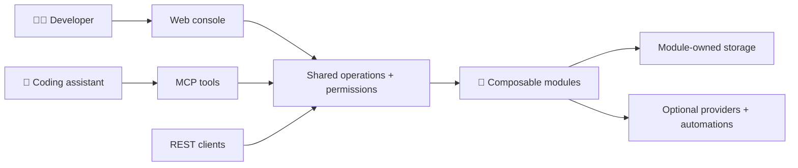
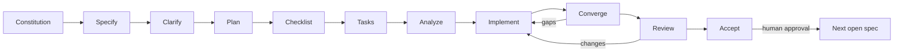

<p align="center">
  
</p>

<p align="center">
  <strong>Your platform. Your ingredients.</strong><br>
  A composable, self-hosted internal developer platform — built to fit your team, not the other way around.
</p>

<p align="center">
  <a href="LICENSE"></a>
  
  <a href="docs/master-spec-inventory.md"></a>
</p>

<p align="center">
  <a href="docs/product-vision.md">🌍 Vision</a> ·
  <a href="docs/architecture.md">🧩 Architecture</a> ·
  <a href="docs/master-spec-inventory.md">🗺️ Roadmap</a> ·
  <a href="CONTRIBUTING.md">🤝 Contribute</a>
</p>

## 🍽️ Meet Köfte

Developers deserve a clear, welcoming home for services, owners, resources and guarded automations. Platform teams deserve the freedom to assemble that experience from modules instead of maintaining a fork.

**Köfte is being designed for both.** Its planned interfaces share the same operations and permissions, whether you work in a browser, call an API, or use an MCP-enabled coding assistant.

| Ingredient                 | What we're working toward                                                                             |
| -------------------------- | ----------------------------------------------------------------------------------------------------- |
| 🧩 Deep composability      | Modules contributing backend features, UI, resources, events, workflows, permissions and MCP tools    |
| 🏠 Self-hosted freedom     | A lightweight SQLite profile, PostgreSQL for shared installations, and first-class Kubernetes support |
| 🤖 Assistant-native access | Early authenticated MCP tools, not a privileged side door                                             |
| ✨ Thoughtful experience   | A fast, accessible Next.js console with clear loading, empty, error and permission states             |
| 🔐 Explicit boundaries     | Team-scoped authorization, audited actions and module-owned storage                                   |

> [!IMPORTANT]
> **Spec 001's bootstrap is human-accepted and merged, not a finished product.** A module-free .NET host, persistent local SQLite store, Next.js status page, local supervisor, owned PostgreSQL verification, guarded recovery and generated Development OpenAPI now exist. All 64 implementation tasks are evidenced, including the complete local gate, all ten actual Ubuntu CI jobs and human-confirmed T056/T059. Final review found no acceptance defect, and [explicit human acceptance](specs/001-repository-bootstrap/acceptance.md) is recorded. Spec 002's offline manifest-validation contracts are [explicitly human-accepted](specs/002-platform-contracts/acceptance.md) and human-merged. Spec 003's storage registry and module isolation are [explicitly human-accepted](specs/003-storage-registry/acceptance.md) and human-merged. Spec 004 is [explicitly human-accepted](specs/004-module-lifecycle/acceptance.md) and [PR #7](https://github.com/Stonefly-Labs/Kofte/pull/7) is now human-merged. Its accepted ledger and evidence were verified on updated main before 005 began. The [full-matrix follow-up](specs/004-module-lifecycle/implementation.md#full-matrix-ci-follow-up) retains prior failures and unknown causes; the historical failed local gate remains failed, not waived by acceptance or merge. Spec 005 now has [authentication/bootstrap requirements](specs/005-authentication-bootstrap/spec.md) and US1 sign-in implemented, not the complete identity feature. Nothing here claims production readiness or MVP completion.

**Current stage: 005 / implement running; 72/100 tasks complete.** T001–T065
and T071–T077 are evidenced. The expanded actual HTTPS TypeScript corpus now
passes thirteen ordinary cases plus the designated-actor case. It exposed and
corrected Node's bare 431 at the admitted header boundary: all Next serving
launchers now give the parser 32 KiB of headroom while Köfte still admits exactly
16 KiB and rejects the next byte with its private 400. T064 now closes with
the complete production/Development corpus on both actual providers.
The independent Development HTTP corpus now also passes through actual native
and Next paths, including the complete method inventory, strict selection,
Origin/CSRF/credential refusal, exact body/header limits and separate cookie.
Both empty/composed scope facts now pass that complete Development corpus on
each real provider in the hosted native platform-contract phase.
T065's complete thirty-case SQLite rerun passes; unchanged both-provider hosted
session and storage/trust-reconciliation suites also pass. Other hosted failures
remain open and do not become a passing full matrix.
The corpus now also proves simultaneous 16-KiB callback-target and header
admission through native/Next paths, with private refusal if either exceeds its
limit. Its initial 414 exposed the owned test HTTPS ingress's smaller parser
limit; only that fixture's framing headroom changed, not product limits.
Native failure reports now retain only allowlisted repository source locations
and in-file line numbers, so recurring hosted assertions can be diagnosed
without publishing private arguments, values, exception text or stack traces.
Actual empty/composed hosts and production Next now
verify concurrent two-user request isolation, direct/adapted identity equality and
first-protected-request rejection of both original cookies after stopped epoch
revocation. Fresh explicit selection preserves each original user ID.
Sixteen SQLite native/HTTPS parity cases now pass
together, including all frozen unsafe returns, every unsupported protocol/API
method, exact combined-header bounds, ambiguous Origin/CSRF/Fetch Metadata
refusal and fixed private 401/403/503 responses without protected effects.
Remaining US3 story/browser/shape acceptance remains open. The local supervisor now refuses broader
host/web binding even with unsafe opt-in, sets both .NET environment variables
to Development and never performs stopped initialization or key repair.
All 88 actual invalid-startup cases per provider pass across empty/composed hosts
and both unsafe-switch settings, preserving prepared storage and keys. T076/T077
now reconcile passing actual provider exposure, HTTP and persisted mode-transition
evidence. The new public `development-isolation` recipe passes 135 independently
validated SQLite observations: all 88 exposure refusals, exact visible
browser/API/actor identity and pending/consumed persisted mode transitions.
Its PostgreSQL execution and T078 acceptance remain pending.
A fresh owned PostgreSQL creation probe
confirms Docker network-pool exhaustion; no existing resources were removed.
Native explicit Development selection now
uses configured synthetic keys, the separate cookie and the existing atomic
user/session/evidence boundary. Four actual SQLite cases verify stable mapping,
strict input, fresh identity-bound CSRF and stopped OIDC↔Development transitions;
old tickets fail and consumed production designation survives without merging
users or granting Development authority. Its exact Next adapter and accessible
configured selector now pass actual native/Next and Chromium journeys, including
fresh CSRF, sign-out, no personal SSR, keyboard access and 320px/200% reflow.
Development remains visibly labeled and selection is always explicit; denial
or uncertainty clears the old identity without automatic retry. The combined
thirty-case SQLite session/sign-out selection now passes, including a forced
database rejection of the required revocation record with the session unchanged.
Both-provider acceptance and the remaining corpus/operations/final gates remain.
Earlier US3 increments added protected durable self-session sign-out, its exact
Next adapter and immediate local identity clearing on confirmed or uncertain
results, without automatic mutation retries or provider-wide logout claims.
Their initial twenty SQLite session/sign-out cases passed in a nineteen-case
selection plus the concurrent-sign-out case; 77 adapter/UI tests passed then. A live key-loss
regression exposed framework decoding that hid unavailable keys as anonymous;
the corrected boundary returns 503. The new actual browser session journey
still fails locally before login, after TLS trust; the published hosted job
now passes all ten HTTPS recipes, including the complete session journey on
both stores. Four additional SQLite live HTTPS parity cases pass, covering
exact ordinary/designated actor identity, actual signed-ID-token refusal,
unavailable keys and private empty unknown-route responses. Retained-key
rotation across two fresh workers and actual development-cookie refusal also
pass locally. The unknown-route regression exposed and corrected Next's
response mismatch with a deny-only 404 handler, never catch-all forwarding.
The independent TypeScript corpus now executes ten ordinary-identity cases and
a fresh designated-actor case through actual native/HTTPS Next paths. It also
exposed native wrong-case/wrong-method 403 responses; exact private 404 handling
is corrected without relaxing authentication. T056's test additions and T061's
public actor probes close, not the full both-provider corpus or US3 gate.
Positive Development coverage is now an explicit corpus prerequisite, so its
test/endpoint work can proceed without a circular delivery dependency. The
[implementation checkpoint](specs/005-authentication-bootstrap/implementation.md)
records actual OIDC dependency adoption and locked inventory (403 npm / 87
NuGet identities), an independent HTTPS issuer, owned interruption fixtures,
independent acceptance corpora, strict configuration parsing and the immutable
public actor-v1 contract. The format-2 migration and exact v1/v2 physical
verification now pass real SQLite/PostgreSQL preservation, rollback,
constraint and tampering tests, including nonempty module EF history/data.
The deadline blocker is resolved by a tested native-handle SQLite execution
path and cancellable PostgreSQL work, retaining the one-second local/four-second
callback limits. Owner metadata and bounded transactional admission now verify
the normal host lease, preserve the epoch and advance only the security revision.
Transactional security events, installation-bound persistent keys and admitted
stopped preparation/configuration reconciliation/session revocation now exist.
The focused both-provider identity/registry/lease gate passes 105 tests; key
tests pass 27 cases and stopped commands pass fourteen both-provider cases.
A reproduced PostgreSQL dump/restore fingerprint regression is corrected;
49 recovery/physical-format cases pass without omitting constraint verification.
The foundation increment adds tested shared route/default-deny/CSRF components and
bounded private diagnostics, including real operator commit/interruption evidence.
A reproduced SQLite pre-open sharing race now retries only that effect-free guard
inside the original deadline. These components are **not working login** and are
installed in both serving entrypoints:
normal serving requires explicit configuration and read-only verification of
prepared storage, acknowledged trust and usable retained keys. Startup does not
perform discovery or silently prepare storage. Existing health contracts remain
unchanged. Foundation units, both-provider storage/startup, stop/privacy recipes
and actual empty/composed browser warm starts pass. Initial failures and the
controlled deadline-test profile are retained in the implementation report.
Exact local user mapping now composes with the caller's owner transaction:
case-sensitive keys, bounded profiles/capacity, creation evidence and rollback
are tested on both stores. Three fresh owner processes and explicit trust/mode
reconciliation preserve exact IDs and consumed designation. This is storage
evidence, not a delivered login. A reproduced composition-recipe preparation
omission is corrected before preservation baselines, without relaxing serving.
The maintained OIDC code+PKCE configuration and bounded HTTPS backchannel now
pass 66 protocol/transport/issuer cases at the pre-session seam,
including independently invalid signatures/nonce/state, actual cancellation,
finite wire/deadline/cache limits and fail-closed key refresh. These components
are not yet registered in product login routes; no session or actor is created
by their test-owned native-handler fixture. The preceding mapping/composition
checkpoint passed all ten product CI jobs and the repository job.
Durable attempts now enforce exact browser/mode/trust/epoch binding, five-minute
expiry, finite quotas, bounded pruning and transactional single consumption on
both stores. Maintained protected state retains the local binding without
exposing it. The validated-login coordinator now commits mapping, user/event,
attempt consumption and a protected server session in one owner transaction
before the framework can publish an opaque cookie. Thirty both-provider
native-handler/session contracts pass, including actual callback-owner kills,
publication failure, fresh-login references, exact idle/absolute expiry,
revocation and both session limits. Ninety-two dependent storage regressions
and four original issuer/native-handler regressions pass.
The product browser-context, protected login/callback and self-only `/me`
routes are now registered in both hosts. Actual maintained handlers verify
CSRF/browser continuity, exact returns, replay refusal and refreshed tokens.
Fresh durable profile/designation populate the API and read-only actor; even
initial designation does not grant an unrelated action. The combined native
commit/session/route/actor gate passes 52 tests on both stores. Generated
identity types preserve all accepted bootstrap operations/components.
Independent adapter/configuration tests now pass 51 cases (78 web tests total).
T034's exact Next routes now pass all sixteen owned live host/Next parity
observations and verified cleanup. The verifier accepts a post-exit `EPERM`
only when a zero-signal kernel check confirms the entire group is absent;
present or unverifiable descendants still fail. T035/T036 deliver `/identity`,
an accessible non-personal shell, deliberate sign-in, fresh no-store checks,
identity-bound token renewal and stale-state clearing. All 98 web units,
lint/types and the production build pass. Browser sign-in now uses a bounded
Next Server Action: the actual Origin and explicit CSRF pair remain required,
without relaxing `no-referrer` or accepting native forms' opaque Origin.
Actual Ubuntu HTTPS login and trust-refusal browser recipes now pass on both
stores at `6be0ee8` and `2f56f35`; local macOS browser lifecycle/cleanup still fails.
The corrected local protocol matrix passes 123/123 and mapping/restart
passes 20/20. An intervening SQLite readiness failure remains recorded with
unknown cause. Both complete provider integration jobs pass at `2f56f35`,
including all three PostgreSQL native commands. US1 is reconciled, not the
whole feature: broader CI still failed composition-contract timeout,
composition recovery and failure-propagation checks. The latter exposed a
reproduced command-matching regression from the new private diagnostic flags;
the focused correction passes 126 Python tests and actual safe CI-report
replay, pending new CI. No verification deadline was increased. Forty-five
tasks remain, including sign-out,
development sessions and identity recovery. The feature is not complete.
The preceding session checkpoint's CI still failed composition and PostgreSQL
failure-propagation baseline timeouts; causes are not established or waived.
The unchanged both-provider composition selector passed locally in 9m49s,
without diagnosing the Linux CI failures. Published `f89c1ec` subsequently
passed all eleven CI contexts. Continue the remaining tasks on the same stage/draft PR #8;
no merge or acceptance yet.

The [US2 increment](specs/005-authentication-bootstrap/implementation.md#us2-nominated-enrollment-and-real-interruption-evidence)
adds stopped private nomination/replacement/disable, protected atomic enrollment,
the exact Next adapter and masked enrollment UI. Both stores pass the
36-case operator/authority/file-interruption matrix, twenty-way HTTP race and
four real enrollment-owner crash cases. SQLite additionally passes all sixteen
HTTP enrollment cases, fifteen retained recovery checks and three actual native
OpenAPI checks. The generated enrollment contract preserves accepted health;
82 identity UI tests, lint/types and production build pass. New browser
enrollment/lost-acknowledgement evidence now passes the existing Ubuntu job on
both databases. Docker's default
network pool is exhausted, blocking fresh local PostgreSQL fixtures; no
unrelated resources were removed. US2 and the complete feature remain unfinished.
The next SQLite preservation regression also passes: twenty eligible submissions
produce one designation, and nonempty module data, assignment and EF history
survive three fresh hosts, actual repeated preparation
and loss/replacement of the administrator's issuer. Enrollment stays consumed
for the newly authenticated ordinary user and stopped renomination is refused;
the PostgreSQL counterpart now passes the complete storage integration project.
CI also exposed an obsolete SQLite crash-retry expectation; the corrected two
interruption cases and fifteen retained clean-recovery cases pass. Browser
enrollment remains under diagnosis. Independent integration projects now all run
after a safely cleaned-up test failure, while the overall suite still fails.
Published `d3813dd` Ubuntu SQLite integration passes all three projects. Enrollment
browser assertions are scoped to the identity panel rather than Next.js's
additional route-announcement alert. The owned ingress now drops only the next
successful enrollment acknowledgement, preserving the real browser TLS/request
path and independently requiring that the drop occurred. One local run passed
the enrollment and safe-return assertions but exceeded the unchanged child
deadline during final cleanup. The corrected `a0c1fb0` Ubuntu browser job now
passes all eight real HTTPS recipes, including both stores' lost-acknowledgement
and twenty-way enrollment journeys. Its complete PostgreSQL integration also
passes all three projects. SQLite host/composition pass; one SQLite storage
crash regression fails in that broader run, with later isolated cases passing.
Timing-sensitive twenty-way tests now use existing exclusive test collections;
their internal contention and production deadlines are unchanged.
Additional signed administrator/verified-email claims cannot designate or
change nominee eligibility. A real stored development session, framework cookie,
fresh `/me` and actor are exercised before its protected enrollment is denied.
This negative fixture is not the still-unimplemented development-login endpoint.
The seventeen SQLite matrix cases each pass across the full selection and its
unchanged isolated replacement retry; the full selection itself retains that
one failure. The expanded `f80eee9` head now passes both complete provider integration jobs
and all eight HTTPS browser recipes, including the new development/authority
negatives and isolated crash regressions. US2 is reconciled; US3 sign-out/session
parity is next. Complete recovery/failure-propagation/composition gates, aggregate
`all`, the remaining stories and final human acceptance are still outstanding.

The following preserves the completed design-stage context. The
[specification](specs/005-authentication-bootstrap/spec.md) and
[16/16 author checklist](specs/005-authentication-bootstrap/checklists/requirements.md)
cover production OIDC, explicitly limited development login, stable user mapping,
one-time first-admin enrollment and browser/API boundaries. Five stories,
22 acceptance scenarios, 22 requirements and seven outcomes define future
evidence, not implementation. Clarification found all ten requirements categories
clear with zero questions and no spec/checklist changes; the
[coverage assessment](docs/development/spec-workflow.md#invocation-and-current-progress)
records the evidence. The [plan](specs/005-authentication-bootstrap/plan.md),
research, data model, versioned identity/operator contracts and future validation
guide now propose OIDC code+PKCE, durable revocable cookie sessions, exact
same-origin adapters, nominated atomic enrollment and explicit platform/recovery
format-2 upgrades. [ADR 0007](docs/adr/0007-authentication-bootstrap-boundary.md)
is now **human-approved for implementation**, recording **"ok, I approve it"**.
Historical planning artifacts remain unchanged; no login code, package adoption,
runtime proof or feature acceptance is introduced by recording this decision.
The [requirements-quality checklist](specs/005-authentication-bootstrap/checklists/quality.md)
now satisfies **36/36 criteria** after explicitly requested assisted evaluation.
Per-item evidence covers identity/access, nominated enrollment, storage/recovery,
UX and operability. **No unresolved requirements gap or new human decision
needs attention.** The spec, planning evidence and 16/16 author checklist are
unchanged. Continue on `feature/005-authentication-bootstrap`
and [draft PR #8](https://github.com/Stonefly-Labs/Kofte/pull/8).
The [100 implementation tasks](specs/005-authentication-bootstrap/tasks.md)
now trace all 22 requirements, seven outcomes, 22 scenarios and twelve design
decisions to path-specific work and explicit dependencies. They include independent
OIDC/actor evidence, twenty-way enrollment and three restarts per real provider,
exact upgrade/recovery preservation, accessible UI and captured privacy.
The read-only [analysis](specs/005-authentication-bootstrap/analysis.md) passes:
29/29 requirements/outcomes and 22/22 scenarios have concrete task coverage,
all 100 tasks are mapped, and 242 dependency edges are acyclic. No actionable
or constitutional issue remains; assessed inputs and reviewer markers are
unchanged at that analysis checkpoint. Implementation is now active with its
original provenance blocker resolved, not complete. No product code, dependency
adoption, runtime proof or feature acceptance is introduced; no intermediate
merge is requested.

## 🧭 The shape of things to come



This is the **planned architecture**, not a diagram of implemented services. PostgreSQL uses a named schema per module; SQLite uses a physical file per module. Hoard, cloud providers and infrastructure engines stay optional.

## 🚀 Start here

1. Read the [product charter](docs/product-charter.md), [vision](docs/product-vision.md) and [architecture](docs/architecture.md).
2. Follow the [contributor workflow](CONTRIBUTING.md), [local bootstrap guide](docs/development/local-development.md) and [assistant/MCP setup](docs/development/assistant-tooling.md).
3. When ready to begin product work, invoke **`drive-speckit`**. Each invocation performs one stage and publishes its result on the **same branch and draft PR for that numbered feature**. No merges between steps; request human merge only after final review and explicit feature acceptance.

Before local startup, select the exact .NET/Node/npm versions in the
[local guide](docs/development/local-development.md) in the current shell.
Preflight identifies a missing or mismatched tool; it does not install tools
or use a different version merely because one is installed elsewhere.

The constitution's initial v1.0.0 was human-merged; its [v2.0.0 workflow amendment](.specify/memory/constitution.md) records the human-directed [one-feature/one-branch correction](docs/adr/0001-feature-delivery-lifecycle.md). Spec **001 / specify** has a [draft specification](specs/001-repository-bootstrap/spec.md) and its [author quality checklist](specs/001-repository-bootstrap/checklists/requirements.md), generated from the exact [inventory prompt](docs/master-spec-inventory.md). **Clarify, plan, checklist, tasks and analyze are complete:** no material requirements ambiguity remained; the [implementation plan](specs/001-repository-bootstrap/plan.md), research, data model, HTTP/UI contracts and future validation guide define the bounded foundation. At the reviewer's explicit request, agent-assisted evaluation of the [requirements-quality checklist](specs/001-repository-bootstrap/checklists/quality.md) satisfied all 36 criteria with evidence and found no blocking requirements gap. The [64-task implementation list](specs/001-repository-bootstrap/tasks.md) maps all four stories, 17 functional requirements and six measurable outcomes to path-specific work, explicit dependencies and mandatory validation. The read-only [analysis](specs/001-repository-bootstrap/analysis.md) passed with 23/23 requirements/outcomes and 15/15 acceptance scenarios covered, no unmapped tasks and no actionable or constitutional findings. This is design/task coverage, not runtime proof.

**Spec 001 is explicitly human-accepted and merged.** The [acceptance record](specs/001-repository-bootstrap/acceptance.md) preserves the exact decision, scope and limits. The [final review](specs/001-repository-bootstrap/review.md) independently traces all 17 functional requirements, six success criteria, 15 acceptance scenarios and twelve constitutional principles to source/tests, with no acceptance defect. Its complete local gate passes all 170 named steps and actual assessed-head Ubuntu CI has matching coverage. Human T056/T059 attestations and reference-machine limitations remain explicit. The earlier [convergence assessment](specs/001-repository-bootstrap/convergence.md), human-approved [ADR 0002](docs/adr/0002-bootstrap-development-baseline.md), [dependency adoption](docs/development/dependencies.md), [implementation evidence](specs/001-repository-bootstrap/implementation.md) and .NET test-source correction remain in force. [PR #4](https://github.com/Stonefly-Labs/Kofte/pull/4) was human-merged with its accepted ledger/evidence on main.

**004 / specify, clarify, plan, checklist, tasks and analyze are complete** on `feature/004-module-lifecycle`, freshly based
on updated main after spec 003's human merge. The
[draft specification](specs/004-module-lifecycle/spec.md) uses the exact inventory
prompt and resolved project template. Five stories, 20 acceptance scenarios,
20 functional requirements and six outcomes cover empty/valid module boot,
dependency/configuration/contribution preflight, ordered lifecycle/migrations,
data-preserving disable/re-enable and safe health/failure diagnostics.
The [built-in author checklist](specs/004-module-lifecycle/checklists/requirements.md)
satisfies 16/16 criteria. Clarification found all ten requirements categories
clear, with zero questions and no spec/checklist changes; the
[coverage assessment](docs/development/spec-workflow.md#invocation-and-current-progress)
records the clarification evidence. The [implementation plan](specs/004-module-lifecycle/plan.md),
research, data model, versioned author/operator contracts and future validation
guide now propose a compiled trusted catalog, whole-set preflight, explicit
offline preparation, supervised ordered lifecycle and safe aggregate health.
[ADR 0006](docs/adr/0006-module-composition-lifecycle.md) is now **human-approved
for implementation**, recording the explicit decision **"yeah approved"**.
The earlier planning artifacts retain their historical Proposed status; this
approval changes no design or Spec Kit stage. Both constitutional design gates
passed at planning; design evidence alone is not runtime proof.
**Checklist review passes** under the reviewer's explicit request:
the [requirements-quality checklist](specs/004-module-lifecycle/checklists/quality.md)
now satisfies **36/36 criteria**, with per-item evidence for composition/lifecycle,
storage/recovery, authority, privacy and retained interface boundaries.
No blocking requirements gap or new human decision remains. Actual DI dependency
adoption is separately recorded in the dependency guide; full provider/process/privacy
proof remains mandatory, not satisfied by checklist marking. The spec, plan and
16/16 author checklist are unchanged.
The [80-task implementation list](specs/004-module-lifecycle/tasks.md) now
orders safe preflight (US2) before startup (US1), then actual assigned
preparation (US3), three-cycle preservation (US4) and health/failure/privacy
(US5). Tasks are path-specific and explicitly dependency-linked;
all 20 scenarios, 20 requirements, six outcomes and twelve design decisions
have task coverage. Independent public consumers, exact both-provider state,
owned termination, private captures and retained full gates remain mandatory
evidence, not results claimed by generation.
The read-only [analysis](specs/004-module-lifecycle/analysis.md) passes with
26/26 requirements/outcomes and 20/20 scenarios covered, all 80 tasks mapped,
118 acyclic dependency edges and no actionable or constitutional finding.
The analysis preserves its historical assessed inputs; verified implementation
markers and exact commands are recorded separately in the
[implementation evidence](specs/004-module-lifecycle/implementation.md).
**The original implementation checkpoint completed all 80 tasks** on this same branch and
[draft PR #7](https://github.com/Stonefly-Labs/Kofte/pull/7).
The immutable contracts, deterministic validation, public no-storage boots and
real relational clean/additive prepare/serve paths now have focused evidence.
All 80 tasks have implementation evidence, including interrupted-migration
recovery, three-cycle exact preservation on both providers and correction,
health/privacy examples. Assessed code head `267efc8` passes the complete
local gate: ten suite/provider reports, all 286 steps and every delivered guide
command, with `completeGate: true`. Its eleven CI contexts and 286 product
steps also pass. Fixture administration has a separate bounded control-plane
budget; the unchanged twenty-by-ten contention workload runs exclusively of
unrelated hosted tests. Product deadlines, assertions and minima are unchanged.
The [final reconciliation](specs/004-module-lifecycle/implementation.md#final-complete-gate-and-implementation-handoff)
preserves earlier failures and exact implementation evidence. Final
review and explicit human acceptance remain separate later stages; this PR
stays draft and no intermediate merge is requested.
The startup gate also exercises two configured-module/web restarts without
replacing the ten retained empty-host warm cycles or extending their budgets.

**First 004 convergence checkpoint (historical): gaps.** The
[assessment](specs/004-module-lifecycle/convergence.md) checks all 46
requirements/outcomes/scenarios, twelve plan decisions, 80 original tasks and
twelve principles. One HIGH partial finding reproduces disabled owners appearing
only as `discovered/passed` in the actual configured host's operator output;
the explicit disabled state exists only in an unprojected in-memory snapshot.
Exactly T081 is appended, preserving every original task byte and marker,
product/test source, approved intent and reviewer-owned checklists.
That checkpoint selected implement on the same draft PR #7. No data-loss,
disabled-callback execution, new design decision or feature acceptance is claimed.

**T081 now implements explicit disabled operator output.** Successful composition
resolution projects the existing disabled snapshot into bounded private
`composition_disabled` records for explicitly false and omitted deployments.
The actual SQLite/PostgreSQL host examples require both forms under fresh
attempts, with zero disabled callbacks/store effects and unchanged anonymous
health. The [implementation increment](specs/004-module-lifecycle/implementation.md#convergence-remediation-t081)
records red/green evidence and retained regressions. That checkpoint selected
follow-up convergence; the historical finding/report and reviewer checklists
remain unchanged.

**Historical follow-up 004 convergence: gaps.** The
[current assessment](specs/004-module-lifecycle/convergence.md) closes F1/T081,
but accepted service names can produce overlong host-generated dependency IDs
and fail activation (HIGH F2). Broad integration passes 102/104 with two
unexpected cleanup failures; unchanged isolated cases pass, without establishing
the cause (MEDIUM F3). Exactly T082-T083 are appended under Phase 10, preserving
all 81 existing tasks and product/test source. That checkpoint selected
implement on the same draft PR #7.

**T082-T083 now implement both scoped corrections.** Full owner-qualified
dependency bindings preserve the accepted 128-character local-name boundary;
actual both-provider public examples require the exact identity and Start.
An incomplete HTTP request reproduced normal-stop failure on both providers.
The composed host now drains within an internal 500-ms budget, preserving the
one-second cleanup action and 15-second total stop bound. Fixed private codes
identify infrastructure cleanup failures without raw error details; intentional
incomplete/uncertain refusal remains enforced. The
[increment evidence](specs/004-module-lifecycle/implementation.md#convergence-remediation-t082-t083)
retains all failed runs and the limits of historical causal attribution.
The local all-suite attempt's two failures remain explicit, not erased by
successful narrowed rechecks.
All 83 then-existing tasks are implemented; that checkpoint selected follow-up
converge on draft PR #7, not review, acceptance or an intermediate merge.

**Historical 004 convergence after T082-T083: gaps.** The
[assessment after T082-T083](specs/004-module-lifecycle/convergence.md) checks
all 46 requirements/outcomes/scenarios, twelve plan decisions, 83 tasks and
twelve principles. F1/T081 and F2/T082 are closed. New HIGH F4 reproduces
accepted compositions failing at 65 prerequisite service bindings or 129
global executable exports. MEDIUM F3 remains open: fresh broad integration
passes 104/106, with SQLite preservation and PostgreSQL correction reporting
private `composition_host_dispose_incomplete`. The HTTP-stop correction passes
but does not establish this disposal cause. Only T084-T085 are appended,
preserving all prior tasks, approved intent, reviewer checklists and product/test
source. That checkpoint selected implement on the same draft PR #7.

**T084-T085 implementation checkpoint (historical).** Executable lifecycle now retains
128 services per owner and 1,024 enabled total, including complete copied
prerequisite bindings. The independent public example requires all 127 Alpha
operations across 129 global exports. A deterministic regression proves that
unused default JSON watchers survived configuration clearing; disabling reload
before builder construction removes that disposal resource without widening
deadlines. The corrected both-provider composition selection passes 106/106;
the complete local gate passes all 286 steps. The
[increment report](specs/004-module-lifecycle/implementation.md#convergence-remediation-t084-t085)
retains all failed evidence and full reconciliation.
Follow-up converge, review and explicit human acceptance remain separate
stages on the same draft PR #7; no intermediate merge is requested.

**004 / convergence after T084-T085 passes (historical checkpoint).** The
[assessment](specs/004-module-lifecycle/convergence.md) covers all 46
requirements/outcomes/scenarios, twelve plan decisions, 85 tasks and twelve
principles with zero actionable gaps. F1-F4 are closed by actual behavior and
evidence; the task file is byte-for-byte unchanged. Approved intent, reviewed
checklists, product/test code and historical reports are preserved. Final
review and explicit human acceptance remain separate on
[draft PR #7](https://github.com/Stonefly-Labs/Kofte/pull/7); no merge is requested.

**004 / final review records changes (historical checkpoint).** The
[review](specs/004-module-lifecycle/review.md) assesses all 46
requirements/outcomes/scenarios, twelve plan decisions, 85 existing tasks and
twelve principles. One HIGH finding R1 reproduces valid disabled-catalog
metadata exceeding an incorrect protocol bound: 16/16 public-host probe cases
fail validate/serve despite accepted resolution and zero enabled edges.
Exactly T086 is appended unchecked, preserving all prior task bytes/markers,
approved intent, reviewer checklists and product/test source. Acceptance is
blocked pending remediation, convergence and passing final review on the same
draft PR #7; no intermediate merge is requested.

**004 / T086 implement complete; separate investigation deferred.** The
[increment](specs/004-module-lifecycle/implementation.md#final-review-remediation-t086)
retains all-catalog diagnostic prerequisites up to 2,048 identities, independently
of the unchanged 1,024 enabled-edge limit. Protocol overflow/copy/identity checks,
public resolution and actual validate/serve regressions cover omitted and
explicit-false selections, full disabled catalogs and an unrelated enabled
module on both providers. Inventory, disabled observations, usable readiness
and owned clean exit pass. All eleven code-head CI contexts and 286 targeted
steps pass. The local complete attempt separately fails a PostgreSQL
migration-interruption test; its isolated pass does not erase that failure.
The human explicitly authorized documenting the eight-pass/one-failure snapshot
and deferring that investigation without blocking this implementation checkpoint.
The [facts and revisit guidance](specs/004-module-lifecycle/implementation.md#human-directed-deferral-and-implementation-handoff)
retain the failed local outcome and unknown cause. T086 is complete;
that implementation checkpoint selected follow-up converge on draft PR #7. Historical review
and acceptance remain unchanged, and no merge is requested.

**Historical 004 / converge passes after T086.** The
[assessment](specs/004-module-lifecycle/convergence.md) covers all 46
requirements/outcomes/scenarios, twelve plan decisions, 86 tasks and twelve
principles with no new actionable gap or appended task. Actual protocol,
resolver and both-provider compiled-host evidence closes review R1; prior
F1-F4 remain closed. The deferred PostgreSQL observation and failed local
full-suite result remain unchanged, not diagnosed or rerun here.
**Review is next** on the same draft PR #7, with that limitation retained;
no feature acceptance, readiness or intermediate merge is implied.

**Historical 004 / final review passes after T086.** The
[review](specs/004-module-lifecycle/review.md) covers all 46 requirements/
outcomes/scenarios, twelve decisions, 86 tasks and twelve principles.
R1/T086 and prior F1-F4 are closed; no new implementation defect or task remains.
The failed/interrupted local 109/111 attempt and human-deferred PostgreSQL
observation remain explicit, undiagnosed and not rerun. Review is not a
full-gate pass or release waiver. **Explicit human acceptance of numbered
feature 004 is next**, separately on
[draft PR #7](https://github.com/Stonefly-Labs/Kofte/pull/7), with that limitation
disclosed; no readiness or merge is requested.

**Current 004 / explicitly human-accepted.** The
[acceptance record](specs/004-module-lifecycle/acceptance.md) preserves the exact
decision **"bro this human fugging accepts"**, responding to the passing review
and disclosed deferred PostgreSQL limitation. Review/tasks/checklists and
historical evidence remain unchanged; the failed local attempt stays failed,
not diagnosed by later passing executions. [PR #7](https://github.com/Stonefly-Labs/Kofte/pull/7)
was returned to draft after subsequent CI failures.
The [follow-up evidence](specs/004-module-lifecycle/implementation.md#post-acceptance-sqlite-ci-failure-and-diagnostic-correction)
records three and 155 unchanged passing local cases without an established
cause; bounded failure diagnostics now preserve the case/assertion for recurrence.
The [full-matrix follow-up](specs/004-module-lifecycle/implementation.md#full-matrix-ci-follow-up)
removes duplicate composition execution without dropping cases or raising
deadlines. A renewed merge handoff requires **all eleven checks on the latest
commit** to finish successfully; the PR records their actual outcomes.
That historical checkpoint left **005 waiting for human merge**. PR #7 is
now human-merged and its accepted evidence was verified on updated main;
the current 005 specification checkpoint is described above. Acceptance itself
started no new feature and waived no release gate.

**Spec 003 is explicitly human-accepted and human-merged.**
The [acceptance record](specs/003-storage-registry/acceptance.md) preserves the
exact decision, **"this human accesspts 003"**, and the passing review's scope
and limits. The [review](specs/003-storage-registry/review.md) covers all 40
requirements/outcomes/scenarios, fourteen plan decisions, 83 tasks and twelve
principles with no remaining finding. Acceptance changes no product/test code,
tasks, reviewed checklists or prior evidence and adds no runtime measurement.
The same [PR #6](https://github.com/Stonefly-Labs/Kofte/pull/6) was human-merged.
Before starting 004, the accepted ledger and all five acceptance evidence hashes
were verified on updated `origin/main`; acceptance itself did not start 004.

The following paragraphs preserve the implementation and earlier stage history.
The initial implementation checkpoint followed completed
specify through analyze and explicit human approval of
[ADR 0005](docs/adr/0005-module-storage-ownership.md).
The [specification](specs/003-storage-registry/spec.md), [plan](specs/003-storage-registry/plan.md)
and [task list](specs/003-storage-registry/tasks.md) retain the approved scope;
the author and reviewer-owned quality checklists remain 16/16 and 36/36.
Reviewed EF/provider dependencies, provider-neutral storage contracts and a
platform-local registry now support immutable allocation, explicit no-storage,
private SQLite files, offline PostgreSQL provisioning and marker verification.
Actual both-provider registration/constraint checks, assigned EF isolation,
the complete 20-by-ten connection/process race matrix, killed-process recovery,
30/120-second worker termination and all-seven-outcome privacy checks now have
focused evidence. All nine public examples execute, including corrected retry,
real interrupted provisioning and provider-backed complete-set restore.
The original PostgreSQL failures did not reproduce in the unchanged 105-case
baseline. Later Linux CI identified a process-worker acquisition deadline:
ownership verification and the first lease probe now share one guarded query,
and worker provider initialization completes before the ten-way race barrier.
Budgets and Busy-only retry rules are unchanged. The corrected complete local
gate passes all 200 steps. Assessed-head Linux CI also passes all ten product
jobs / 200 steps and repository checks after the browser-prerequisite mirror
correction documented in the local guide. The implementation checkpoint marked
all 78 original tasks complete; convergence identifies two remaining public-example
obligations below rather than inferring acceptance from those markers.
Baseline provider selection and warm-restart fixtures now honor the new
registry/module ownership boundary without weakening its checks.
See the [implementation report](specs/003-storage-registry/implementation.md)
for exact revisions, commands, results and supported limits, and the
[validation guide](specs/003-storage-registry/quickstart.md) for supported checks
and executable examples. Normal serving remains module-free; storage is not
a new endpoint, module loader or authorization bypass. Work stays on
`feature/003-storage-registry` and [draft PR #6](https://github.com/Stonefly-Labs/Kofte/pull/6).
The first [convergence assessment](specs/003-storage-registry/convergence.md)
identified two HIGH partial public-example gaps and appended **T079-T080**.
The [remediation increment](specs/003-storage-registry/implementation.md#convergence-remediation-t079-t080)
now makes `same-id-retry` release maintenance and launch three fresh processes,
each re-registering changed metadata and verifying two exact assignments and
retained sentinels. `collision` now forces a second distinct ID against a
registered owner's candidate, verifies the real UNIQUE rejection and unchanged
assignment/data/inventory, and retains the separate unowned-target refusal.
Standalone and `all` harnesses require these observations, not positive counts
alone. All 80 tasks are evidenced; no runtime storage rule or dependency changes.
The [follow-up convergence](specs/003-storage-registry/convergence.md) now
assesses all 40 requirements/outcomes/scenarios, fourteen plan decisions,
80 tasks and twelve principles against current source/tests, with zero actionable
gaps. Both public-example findings are closed; `tasks.md` is byte-for-byte
unchanged and no product/test code is edited by convergence. Actual assessed-head
CI passes all eleven contexts and 200 product steps. **Review is next** on this
same draft PR, followed separately by explicit numbered-feature acceptance.
The earlier gaps assessment is preserved as history; convergence does not
perform final review, accept the feature or request a merge.

The subsequent [final review](specs/003-storage-registry/review.md) records
**changes** for one MEDIUM evidence finding: the prescribed changed-allocator
retry of an existing mapping and persisted no-storage-to-relational refusal
lack regression assertions. Production code appears correct; no storage-engine
failure is demonstrated. Prior public F1/F2 are closed. Exactly **T081** is
appended, preserving all 80 historical task markers and earlier reports.
Fresh quality/unit/both-provider integration/recovery/contract/privacy gates
pass 157 targeted steps; actual assessed-head CI passes eleven contexts and
200 product steps. Passing existing tests does not supply the absent cases.
That review selected implement without a new approval or merge prerequisite.
The [T081 implementation](specs/003-storage-registry/implementation.md#final-review-remediation-t081)
now adds both inherited regressions: all four real-provider cases pass and
detect controlled behavioral mutations. Exact assignments, sentinels, revisions
and complete inventory remain unchanged after reopening. All 81 tasks are
evidenced; fresh quality/unit/integration gates pass 46 targeted steps after
an unchanged PostgreSQL rerun of two initial deadline failures. Production,
APIs and dependencies are unchanged.
The [current convergence](specs/003-storage-registry/convergence.md) now assesses
all 40 requirements/outcomes/scenarios, fourteen plan decisions, all 81 tasks
and twelve principles against actual source/assertions. R1/T081 and prior public
F1/F2 are closed, with zero actionable gaps and no appended task. Tasks,
product/test code, approved intent and the historical review remain unchanged.
That convergence selected review on the same draft PR. The subsequent
[follow-up final review](specs/003-storage-registry/review.md) confirms R1/T081
and public F1/F2 are closed, but identifies one MEDIUM implementation finding
R2: explicit registry-upgrade mutations and rejected boundaries bypass required
correlated storage records. Existing CLI success/generic failure summaries do
not supply the direct API's complete operation evidence. Exactly **T082** is
appended unchecked for safe direct-API/CLI telemetry and both-provider captures;
all 81 historical task bytes/markers, code, design and earlier reports remain
unchanged. No storage-isolation failure or new design decision is demonstrated.
Fresh relevant gates pass 157 targeted steps; actual assessed-head CI passes
eleven contexts and 200 product steps, not the absent upgrade-record assertions.
That review selected implement without accepting the feature or requesting merge.
The [T082 increment](specs/003-storage-registry/implementation.md#final-review-remediation-t082)
now emits correlated upgrade and failed-acquisition records with fixed guidance
and truthful durability, without manufacturing a module result. The CLI projects
allowlisted worker outcomes while continuing to discard raw child output.
Both-provider captures cover commit, idempotent retry, rejected scopes,
unsupported/corrupt registries and sanitized commit-boundary failures.
All 82 tasks were evidenced at that implementation checkpoint, which selected
follow-up converge. That assessment appended T083 without rewriting
those historical markers; the implementation increment above completes it,
while feature acceptance remains separate.

**Spec 002 is explicitly human-accepted and merged.**
The [acceptance record](specs/002-platform-contracts/acceptance.md) preserves
the exact decision, **"spec is fully human approved"**, in response to the
passing final review and explicit numbered-feature acceptance handoff.
Acceptance retains the approved scope and review limits; it adds no product
capability or new measurement. The same [PR #5](https://github.com/Stonefly-Labs/Kofte/pull/5)
was human-merged. Before starting 003, all five acceptance evidence hashes and
the accepted ledger were verified on updated `origin/main`; acceptance itself
did not begin the next feature.

The completed review checkpoint follows.
The [final review](specs/002-platform-contracts/review.md) independently traces
all 15 functional requirements, six amended outcomes, 14 scenarios, twelve plan
decisions, 49 tasks and twelve principles to actual source/tests. No acceptance
defect or remediation remains. Fresh quality/unit/both-provider contract checks
pass all 62 targeted steps; actual assessed-head CI passes all eleven contexts
and 177 product steps. This is not a new local all-suite or human-usability
claim. Review did not accept the feature; the separate explicit human decision
is now recorded above.

The preceding convergence/remediation checkpoint follows.
The [implementation increment](specs/002-platform-contracts/implementation.md#convergence-remediation-t049)
adds the documented public boundary recipes, reversed range and ordered
multi-error/truncation cases identified by the
[prior convergence assessment](specs/002-platform-contracts/convergence.md).
Every corpus case now runs 100 times through each public consumer in both real
`en-US` and `tr-TR` cultures, including recursively reordered properties;
corrected retry remains covered. Focused quality/unit/both-provider contract gates pass; no
production code or contract rule changed. The
[follow-up convergence](specs/002-platform-contracts/convergence.md) now assesses
all 35 requirements/outcomes/scenarios, twelve plan decisions, 49 tasks and
twelve principles with zero actionable gaps. It leaves `tasks.md` byte-for-byte
unchanged. The passing final review above is separate from human acceptance.

The original completed implementation checkpoint follows.
The [approved design](docs/adr/0004-module-manifest-contract.md) now has a pure
`Kofte.Platform` library with strict bounded JSON, immutable identity, SemVer
compatibility, safe ordered diagnostics and non-authoritative declarations.
The [executable author guide](specs/002-platform-contracts/quickstart.md) uses a
test-owned console; host-facing and structural consumers verify the same contract
without loading modules or adding routes/storage. [Implementation evidence](specs/002-platform-contracts/implementation.md)
records focused tests, observed privacy/retry behavior, dependency review and
complete implementation evidence. The human removed the fixed Ubuntu/CPU/RAM benchmark profile;
T044 is evidenced on the available supported workstation with actual metadata
and 100 individually timed checks. The human also removed T045's manual timed
exercise; actual automated guide/error/corrected-retry checks now satisfy it.
No human study or elapsed-time attestation is claimed. All 49
implementation tasks, including T049's corpus remediation, have recorded
evidence. Follow-up convergence and final review pass; the separate acceptance
record above now completes the feature's human decision.
The [task list, now including T049](specs/002-platform-contracts/tasks.md), passing
[analysis](specs/002-platform-contracts/analysis.md), 16/16 author checklist and
36/36 reviewer-authorized quality checklist preserve traceability, not acceptance.
All 002 stages stayed on `feature/002-platform-contracts` and
[PR #5](https://github.com/Stonefly-Labs/Kofte/pull/5) through human acceptance
and merge; there was no intermediate merge or inferred acceptance.
**Installing a skill does not execute it.**



See [Spec Kit workflow and recovery](docs/development/spec-workflow.md) for stage gates, durable state and acceptance.

## 🗂️ Repository map

```text
.github/       Contributor templates, Copilot instructions, skills, agents and CI
.specify/      Existing Spec Kit templates/scripts and tracked driver progress
.vscode/       Shared editor MCP configuration
apps/web/      Minimal Next.js bootstrap page and fixed readiness adapter
src/           .NET host and pure platform manifest/identity contracts
modules/       Reserved for independently packaged reference modules
packages/      Bootstrap contract; UI/module SDK placeholders remain reserved
tests/         Dedicated .NET test projects, HTTP contract and browser tests
deploy/        Pinned disposable PostgreSQL Compose; Helm remains reserved
scripts/       Repository/dependency checks, supervisor, verifier and their tests
specs/         Numbered Spec Kit artifacts (not docs/specs/)
docs/          Product context, decisions, contributor guides and visual assets
```

The bootstrap and approved platform manifest contracts are implemented: one host,
one web app and narrow shared contracts. Modules, module/UI SDKs, workers and Helm
remain reserved. No application tables, fake identity, feature/admin/MCP routes
or module isolation are introduced by this foundation.

.NET test source belongs inside its dedicated test project under `tests/`,
never in production projects or linked from production vertical slices. Test
projects may mirror feature ownership; see the human-approved
[source ownership decision](docs/adr/0003-dotnet-test-source-ownership.md).

## 📚 Project bookshelf

| Read                                                       | Why                                                                                |
| ---------------------------------------------------------- | ---------------------------------------------------------------------------------- |
| [Product charter](docs/product-charter.md)                 | Mandate, boundaries and required outcomes                                          |
| [Product vision](docs/product-vision.md)                   | People, experience and long-term direction                                         |
| [Technical architecture](docs/architecture.md)             | Canonical architecture requirements and proposals                                  |
| [Constitution](.specify/memory/constitution.md)            | Product principles and delivery gates; v2.0.1 clarifies .NET test-source ownership |
| [Master spec inventory](docs/master-spec-inventory.md)     | Ordered prompts; **001–024 MVP**, **025–038 post-MVP**                             |
| [Contributing](CONTRIBUTING.md)                            | Fresh branches, checks, commits, pushes and PR handoffs                            |
| [Local development](docs/development/local-development.md) | Current bootstrap startup, prerequisites, checks and remaining limits              |
| [Assistant tooling](docs/development/assistant-tooling.md) | Microsoft Learn, Context7, Next.js, shadcn/ui and Playwright                       |
| [Spec workflow](docs/development/spec-workflow.md)         | One-stage driver, checkpoints and human acceptance                                 |
| [Architecture decisions](docs/adr/README.md)               | Recording consequential choices without silently changing invariants               |

The [older stack exploration](docs/kofte-technology-stack-architecture.md) is background, not authority over the charter, architecture or exact inventory scope.

## 🤝 Build it together

Open a focused [issue](https://github.com/Stonefly-Labs/Kofte/issues/new/choose), discuss a proposed slice, and keep each PR reviewable. Every change updates the README and related docs where behavior, setup or progress changes.

**Humans merge and close PRs. Assistants never do.**

## 📄 License

[MIT](LICENSE) · Stonefly Labs

<p align="center"><sub>Small core. Great modules. A platform with room for your recipe. 🧆</sub></p>
