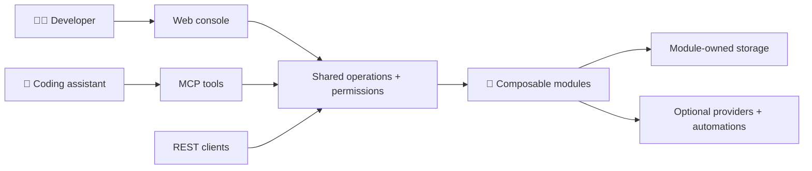
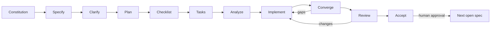

<p align="center">
  
</p>

<p align="center">
  <strong>Your platform. Your ingredients.</strong><br>
  A composable, self-hosted internal developer platform — built to fit your team, not the other way around.
</p>

<p align="center">
  <a href="LICENSE"></a>
  
  <a href="docs/master-spec-inventory.md"></a>
</p>

<p align="center">
  <a href="docs/product-vision.md">🌍 Vision</a> ·
  <a href="docs/architecture.md">🧩 Architecture</a> ·
  <a href="docs/master-spec-inventory.md">🗺️ Roadmap</a> ·
  <a href="CONTRIBUTING.md">🤝 Contribute</a>
</p>

## 🍽️ Meet Köfte

Developers deserve a clear, welcoming home for services, owners, resources and guarded automations. Platform teams deserve the freedom to assemble that experience from modules instead of maintaining a fork.

**Köfte is being designed for both.** Its planned interfaces share the same operations and permissions, whether you work in a browser, call an API, or use an MCP-enabled coding assistant.

| Ingredient                 | What we're working toward                                                                             |
| -------------------------- | ----------------------------------------------------------------------------------------------------- |
| 🧩 Deep composability      | Modules contributing backend features, UI, resources, events, workflows, permissions and MCP tools    |
| 🏠 Self-hosted freedom     | A lightweight SQLite profile, PostgreSQL for shared installations, and first-class Kubernetes support |
| 🤖 Assistant-native access | Early authenticated MCP tools, not a privileged side door                                             |
| ✨ Thoughtful experience   | A fast, accessible Next.js console with clear loading, empty, error and permission states             |
| 🔐 Explicit boundaries     | Team-scoped authorization, audited actions and module-owned storage                                   |

> [!IMPORTANT]
> **Spec 001's bootstrap is human-accepted and merged, not a finished product.** A module-free .NET host, persistent local SQLite store, Next.js status page, local supervisor, owned PostgreSQL verification, guarded recovery and generated Development OpenAPI now exist. All 64 implementation tasks are evidenced, including the complete local gate, all ten actual Ubuntu CI jobs and human-confirmed T056/T059. Final review found no acceptance defect, and [explicit human acceptance](specs/001-repository-bootstrap/acceptance.md) is recorded. Spec 002's offline manifest-validation contracts are [explicitly human-accepted](specs/002-platform-contracts/acceptance.md) and human-merged. Spec 003's storage registry and module isolation are [explicitly human-accepted](specs/003-storage-registry/acceptance.md) and human-merged. Spec 004's [T086 fix](specs/004-module-lifecycle/implementation.md#final-review-remediation-t086) corrects disabled-catalog diagnostic metadata admission; all eleven code-head CI contexts pass. Implementation remains blocked by a separate local complete-gate failure. Convergence, passing final review and explicit human acceptance remain later stages on the same draft PR. Prior convergence findings remain closed. Nothing here claims production readiness or MVP completion.

## 🧭 The shape of things to come



This is the **planned architecture**, not a diagram of implemented services. PostgreSQL uses a named schema per module; SQLite uses a physical file per module. Hoard, cloud providers and infrastructure engines stay optional.

## 🚀 Start here

1. Read the [product charter](docs/product-charter.md), [vision](docs/product-vision.md) and [architecture](docs/architecture.md).
2. Follow the [contributor workflow](CONTRIBUTING.md), [local bootstrap guide](docs/development/local-development.md) and [assistant/MCP setup](docs/development/assistant-tooling.md).
3. When ready to begin product work, invoke **`drive-speckit`**. Each invocation performs one stage and publishes its result on the **same branch and draft PR for that numbered feature**. No merges between steps; request human merge only after final review and explicit feature acceptance.

Before local startup, select the exact .NET/Node/npm versions in the
[local guide](docs/development/local-development.md) in the current shell.
Preflight identifies a missing or mismatched tool; it does not install tools
or use a different version merely because one is installed elsewhere.

The constitution's initial v1.0.0 was human-merged; its [v2.0.0 workflow amendment](.specify/memory/constitution.md) records the human-directed [one-feature/one-branch correction](docs/adr/0001-feature-delivery-lifecycle.md). Spec **001 / specify** has a [draft specification](specs/001-repository-bootstrap/spec.md) and its [author quality checklist](specs/001-repository-bootstrap/checklists/requirements.md), generated from the exact [inventory prompt](docs/master-spec-inventory.md). **Clarify, plan, checklist, tasks and analyze are complete:** no material requirements ambiguity remained; the [implementation plan](specs/001-repository-bootstrap/plan.md), research, data model, HTTP/UI contracts and future validation guide define the bounded foundation. At the reviewer's explicit request, agent-assisted evaluation of the [requirements-quality checklist](specs/001-repository-bootstrap/checklists/quality.md) satisfied all 36 criteria with evidence and found no blocking requirements gap. The [64-task implementation list](specs/001-repository-bootstrap/tasks.md) maps all four stories, 17 functional requirements and six measurable outcomes to path-specific work, explicit dependencies and mandatory validation. The read-only [analysis](specs/001-repository-bootstrap/analysis.md) passed with 23/23 requirements/outcomes and 15/15 acceptance scenarios covered, no unmapped tasks and no actionable or constitutional findings. This is design/task coverage, not runtime proof.

**Spec 001 is explicitly human-accepted and merged.** The [acceptance record](specs/001-repository-bootstrap/acceptance.md) preserves the exact decision, scope and limits. The [final review](specs/001-repository-bootstrap/review.md) independently traces all 17 functional requirements, six success criteria, 15 acceptance scenarios and twelve constitutional principles to source/tests, with no acceptance defect. Its complete local gate passes all 170 named steps and actual assessed-head Ubuntu CI has matching coverage. Human T056/T059 attestations and reference-machine limitations remain explicit. The earlier [convergence assessment](specs/001-repository-bootstrap/convergence.md), human-approved [ADR 0002](docs/adr/0002-bootstrap-development-baseline.md), [dependency adoption](docs/development/dependencies.md), [implementation evidence](specs/001-repository-bootstrap/implementation.md) and .NET test-source correction remain in force. [PR #4](https://github.com/Stonefly-Labs/Kofte/pull/4) was human-merged with its accepted ledger/evidence on main.

**004 / specify, clarify, plan, checklist, tasks and analyze are complete** on `feature/004-module-lifecycle`, freshly based
on updated main after spec 003's human merge. The
[draft specification](specs/004-module-lifecycle/spec.md) uses the exact inventory
prompt and resolved project template. Five stories, 20 acceptance scenarios,
20 functional requirements and six outcomes cover empty/valid module boot,
dependency/configuration/contribution preflight, ordered lifecycle/migrations,
data-preserving disable/re-enable and safe health/failure diagnostics.
The [built-in author checklist](specs/004-module-lifecycle/checklists/requirements.md)
satisfies 16/16 criteria. Clarification found all ten requirements categories
clear, with zero questions and no spec/checklist changes; the
[coverage assessment](docs/development/spec-workflow.md#invocation-and-current-progress)
records the clarification evidence. The [implementation plan](specs/004-module-lifecycle/plan.md),
research, data model, versioned author/operator contracts and future validation
guide now propose a compiled trusted catalog, whole-set preflight, explicit
offline preparation, supervised ordered lifecycle and safe aggregate health.
[ADR 0006](docs/adr/0006-module-composition-lifecycle.md) is now **human-approved
for implementation**, recording the explicit decision **"yeah approved"**.
The earlier planning artifacts retain their historical Proposed status; this
approval changes no design or Spec Kit stage. Both constitutional design gates
passed at planning; design evidence alone is not runtime proof.
**Checklist review passes** under the reviewer's explicit request:
the [requirements-quality checklist](specs/004-module-lifecycle/checklists/quality.md)
now satisfies **36/36 criteria**, with per-item evidence for composition/lifecycle,
storage/recovery, authority, privacy and retained interface boundaries.
No blocking requirements gap or new human decision remains. Actual DI dependency
adoption is separately recorded in the dependency guide; full provider/process/privacy
proof remains mandatory, not satisfied by checklist marking. The spec, plan and
16/16 author checklist are unchanged.
The [80-task implementation list](specs/004-module-lifecycle/tasks.md) now
orders safe preflight (US2) before startup (US1), then actual assigned
preparation (US3), three-cycle preservation (US4) and health/failure/privacy
(US5). Tasks are path-specific and explicitly dependency-linked;
all 20 scenarios, 20 requirements, six outcomes and twelve design decisions
have task coverage. Independent public consumers, exact both-provider state,
owned termination, private captures and retained full gates remain mandatory
evidence, not results claimed by generation.
The read-only [analysis](specs/004-module-lifecycle/analysis.md) passes with
26/26 requirements/outcomes and 20/20 scenarios covered, all 80 tasks mapped,
118 acyclic dependency edges and no actionable or constitutional finding.
The analysis preserves its historical assessed inputs; verified implementation
markers and exact commands are recorded separately in the
[implementation evidence](specs/004-module-lifecycle/implementation.md).
**The original implementation checkpoint completed all 80 tasks** on this same branch and
[draft PR #7](https://github.com/Stonefly-Labs/Kofte/pull/7).
The immutable contracts, deterministic validation, public no-storage boots and
real relational clean/additive prepare/serve paths now have focused evidence.
All 80 tasks have implementation evidence, including interrupted-migration
recovery, three-cycle exact preservation on both providers and correction,
health/privacy examples. Assessed code head `267efc8` passes the complete
local gate: ten suite/provider reports, all 286 steps and every delivered guide
command, with `completeGate: true`. Its eleven CI contexts and 286 product
steps also pass. Fixture administration has a separate bounded control-plane
budget; the unchanged twenty-by-ten contention workload runs exclusively of
unrelated hosted tests. Product deadlines, assertions and minima are unchanged.
The [final reconciliation](specs/004-module-lifecycle/implementation.md#final-complete-gate-and-implementation-handoff)
preserves earlier failures and exact implementation evidence. Final
review and explicit human acceptance remain separate later stages; this PR
stays draft and no intermediate merge is requested.
The startup gate also exercises two configured-module/web restarts without
replacing the ten retained empty-host warm cycles or extending their budgets.

**First 004 convergence checkpoint (historical): gaps.** The
[assessment](specs/004-module-lifecycle/convergence.md) checks all 46
requirements/outcomes/scenarios, twelve plan decisions, 80 original tasks and
twelve principles. One HIGH partial finding reproduces disabled owners appearing
only as `discovered/passed` in the actual configured host's operator output;
the explicit disabled state exists only in an unprojected in-memory snapshot.
Exactly T081 is appended, preserving every original task byte and marker,
product/test source, approved intent and reviewer-owned checklists.
That checkpoint selected implement on the same draft PR #7. No data-loss,
disabled-callback execution, new design decision or feature acceptance is claimed.

**T081 now implements explicit disabled operator output.** Successful composition
resolution projects the existing disabled snapshot into bounded private
`composition_disabled` records for explicitly false and omitted deployments.
The actual SQLite/PostgreSQL host examples require both forms under fresh
attempts, with zero disabled callbacks/store effects and unchanged anonymous
health. The [implementation increment](specs/004-module-lifecycle/implementation.md#convergence-remediation-t081)
records red/green evidence and retained regressions. That checkpoint selected
follow-up convergence; the historical finding/report and reviewer checklists
remain unchanged.

**Historical follow-up 004 convergence: gaps.** The
[current assessment](specs/004-module-lifecycle/convergence.md) closes F1/T081,
but accepted service names can produce overlong host-generated dependency IDs
and fail activation (HIGH F2). Broad integration passes 102/104 with two
unexpected cleanup failures; unchanged isolated cases pass, without establishing
the cause (MEDIUM F3). Exactly T082-T083 are appended under Phase 10, preserving
all 81 existing tasks and product/test source. That checkpoint selected
implement on the same draft PR #7.

**T082-T083 now implement both scoped corrections.** Full owner-qualified
dependency bindings preserve the accepted 128-character local-name boundary;
actual both-provider public examples require the exact identity and Start.
An incomplete HTTP request reproduced normal-stop failure on both providers.
The composed host now drains within an internal 500-ms budget, preserving the
one-second cleanup action and 15-second total stop bound. Fixed private codes
identify infrastructure cleanup failures without raw error details; intentional
incomplete/uncertain refusal remains enforced. The
[increment evidence](specs/004-module-lifecycle/implementation.md#convergence-remediation-t082-t083)
retains all failed runs and the limits of historical causal attribution.
The local all-suite attempt's two failures remain explicit, not erased by
successful narrowed rechecks.
All 83 then-existing tasks are implemented; that checkpoint selected follow-up
converge on draft PR #7, not review, acceptance or an intermediate merge.

**Historical 004 convergence after T082-T083: gaps.** The
[assessment after T082-T083](specs/004-module-lifecycle/convergence.md) checks
all 46 requirements/outcomes/scenarios, twelve plan decisions, 83 tasks and
twelve principles. F1/T081 and F2/T082 are closed. New HIGH F4 reproduces
accepted compositions failing at 65 prerequisite service bindings or 129
global executable exports. MEDIUM F3 remains open: fresh broad integration
passes 104/106, with SQLite preservation and PostgreSQL correction reporting
private `composition_host_dispose_incomplete`. The HTTP-stop correction passes
but does not establish this disposal cause. Only T084-T085 are appended,
preserving all prior tasks, approved intent, reviewer checklists and product/test
source. That checkpoint selected implement on the same draft PR #7.

**T084-T085 implementation checkpoint (historical).** Executable lifecycle now retains
128 services per owner and 1,024 enabled total, including complete copied
prerequisite bindings. The independent public example requires all 127 Alpha
operations across 129 global exports. A deterministic regression proves that
unused default JSON watchers survived configuration clearing; disabling reload
before builder construction removes that disposal resource without widening
deadlines. The corrected both-provider composition selection passes 106/106;
the complete local gate passes all 286 steps. The
[increment report](specs/004-module-lifecycle/implementation.md#convergence-remediation-t084-t085)
retains all failed evidence and full reconciliation.
Follow-up converge, review and explicit human acceptance remain separate
stages on the same draft PR #7; no intermediate merge is requested.

**004 / convergence after T084-T085 passes (historical checkpoint).** The
[assessment](specs/004-module-lifecycle/convergence.md) covers all 46
requirements/outcomes/scenarios, twelve plan decisions, 85 tasks and twelve
principles with zero actionable gaps. F1-F4 are closed by actual behavior and
evidence; the task file is byte-for-byte unchanged. Approved intent, reviewed
checklists, product/test code and historical reports are preserved. Final
review and explicit human acceptance remain separate on
[draft PR #7](https://github.com/Stonefly-Labs/Kofte/pull/7); no merge is requested.

**004 / final review records changes (historical checkpoint).** The
[review](specs/004-module-lifecycle/review.md) assesses all 46
requirements/outcomes/scenarios, twelve plan decisions, 85 existing tasks and
twelve principles. One HIGH finding R1 reproduces valid disabled-catalog
metadata exceeding an incorrect protocol bound: 16/16 public-host probe cases
fail validate/serve despite accepted resolution and zero enabled edges.
Exactly T086 is appended unchecked, preserving all prior task bytes/markers,
approved intent, reviewer checklists and product/test source. Acceptance is
blocked pending remediation, convergence and passing final review on the same
draft PR #7; no intermediate merge is requested.

**004 / T086 fix published; implement is blocked.** The
[increment](specs/004-module-lifecycle/implementation.md#final-review-remediation-t086)
retains all-catalog diagnostic prerequisites up to 2,048 identities, independently
of the unchanged 1,024 enabled-edge limit. Protocol overflow/copy/identity checks,
public resolution and actual validate/serve regressions cover omitted and
explicit-false selections, full disabled catalogs and an unrelated enabled
module on both providers. Inventory, disabled observations, usable readiness
and owned clean exit pass. All eleven code-head CI contexts and 286 targeted
steps pass. The local complete attempt separately fails a PostgreSQL
migration-interruption test; its isolated pass does not erase that failure.
T086 stays unchecked and the driver records blocked implement on draft PR #7.
Resume that stage before convergence; historical review and acceptance remain
unchanged, and no merge is requested.

**Spec 003 is explicitly human-accepted and human-merged.**
The [acceptance record](specs/003-storage-registry/acceptance.md) preserves the
exact decision, **"this human accesspts 003"**, and the passing review's scope
and limits. The [review](specs/003-storage-registry/review.md) covers all 40
requirements/outcomes/scenarios, fourteen plan decisions, 83 tasks and twelve
principles with no remaining finding. Acceptance changes no product/test code,
tasks, reviewed checklists or prior evidence and adds no runtime measurement.
The same [PR #6](https://github.com/Stonefly-Labs/Kofte/pull/6) was human-merged.
Before starting 004, the accepted ledger and all five acceptance evidence hashes
were verified on updated `origin/main`; acceptance itself did not start 004.

The following paragraphs preserve the implementation and earlier stage history.
The initial implementation checkpoint followed completed
specify through analyze and explicit human approval of
[ADR 0005](docs/adr/0005-module-storage-ownership.md).
The [specification](specs/003-storage-registry/spec.md), [plan](specs/003-storage-registry/plan.md)
and [task list](specs/003-storage-registry/tasks.md) retain the approved scope;
the author and reviewer-owned quality checklists remain 16/16 and 36/36.
Reviewed EF/provider dependencies, provider-neutral storage contracts and a
platform-local registry now support immutable allocation, explicit no-storage,
private SQLite files, offline PostgreSQL provisioning and marker verification.
Actual both-provider registration/constraint checks, assigned EF isolation,
the complete 20-by-ten connection/process race matrix, killed-process recovery,
30/120-second worker termination and all-seven-outcome privacy checks now have
focused evidence. All nine public examples execute, including corrected retry,
real interrupted provisioning and provider-backed complete-set restore.
The original PostgreSQL failures did not reproduce in the unchanged 105-case
baseline. Later Linux CI identified a process-worker acquisition deadline:
ownership verification and the first lease probe now share one guarded query,
and worker provider initialization completes before the ten-way race barrier.
Budgets and Busy-only retry rules are unchanged. The corrected complete local
gate passes all 200 steps. Assessed-head Linux CI also passes all ten product
jobs / 200 steps and repository checks after the browser-prerequisite mirror
correction documented in the local guide. The implementation checkpoint marked
all 78 original tasks complete; convergence identifies two remaining public-example
obligations below rather than inferring acceptance from those markers.
Baseline provider selection and warm-restart fixtures now honor the new
registry/module ownership boundary without weakening its checks.
See the [implementation report](specs/003-storage-registry/implementation.md)
for exact revisions, commands, results and supported limits, and the
[validation guide](specs/003-storage-registry/quickstart.md) for supported checks
and executable examples. Normal serving remains module-free; storage is not
a new endpoint, module loader or authorization bypass. Work stays on
`feature/003-storage-registry` and [draft PR #6](https://github.com/Stonefly-Labs/Kofte/pull/6).
The first [convergence assessment](specs/003-storage-registry/convergence.md)
identified two HIGH partial public-example gaps and appended **T079-T080**.
The [remediation increment](specs/003-storage-registry/implementation.md#convergence-remediation-t079-t080)
now makes `same-id-retry` release maintenance and launch three fresh processes,
each re-registering changed metadata and verifying two exact assignments and
retained sentinels. `collision` now forces a second distinct ID against a
registered owner's candidate, verifies the real UNIQUE rejection and unchanged
assignment/data/inventory, and retains the separate unowned-target refusal.
Standalone and `all` harnesses require these observations, not positive counts
alone. All 80 tasks are evidenced; no runtime storage rule or dependency changes.
The [follow-up convergence](specs/003-storage-registry/convergence.md) now
assesses all 40 requirements/outcomes/scenarios, fourteen plan decisions,
80 tasks and twelve principles against current source/tests, with zero actionable
gaps. Both public-example findings are closed; `tasks.md` is byte-for-byte
unchanged and no product/test code is edited by convergence. Actual assessed-head
CI passes all eleven contexts and 200 product steps. **Review is next** on this
same draft PR, followed separately by explicit numbered-feature acceptance.
The earlier gaps assessment is preserved as history; convergence does not
perform final review, accept the feature or request a merge.

The subsequent [final review](specs/003-storage-registry/review.md) records
**changes** for one MEDIUM evidence finding: the prescribed changed-allocator
retry of an existing mapping and persisted no-storage-to-relational refusal
lack regression assertions. Production code appears correct; no storage-engine
failure is demonstrated. Prior public F1/F2 are closed. Exactly **T081** is
appended, preserving all 80 historical task markers and earlier reports.
Fresh quality/unit/both-provider integration/recovery/contract/privacy gates
pass 157 targeted steps; actual assessed-head CI passes eleven contexts and
200 product steps. Passing existing tests does not supply the absent cases.
That review selected implement without a new approval or merge prerequisite.
The [T081 implementation](specs/003-storage-registry/implementation.md#final-review-remediation-t081)
now adds both inherited regressions: all four real-provider cases pass and
detect controlled behavioral mutations. Exact assignments, sentinels, revisions
and complete inventory remain unchanged after reopening. All 81 tasks are
evidenced; fresh quality/unit/integration gates pass 46 targeted steps after
an unchanged PostgreSQL rerun of two initial deadline failures. Production,
APIs and dependencies are unchanged.
The [current convergence](specs/003-storage-registry/convergence.md) now assesses
all 40 requirements/outcomes/scenarios, fourteen plan decisions, all 81 tasks
and twelve principles against actual source/assertions. R1/T081 and prior public
F1/F2 are closed, with zero actionable gaps and no appended task. Tasks,
product/test code, approved intent and the historical review remain unchanged.
That convergence selected review on the same draft PR. The subsequent
[follow-up final review](specs/003-storage-registry/review.md) confirms R1/T081
and public F1/F2 are closed, but identifies one MEDIUM implementation finding
R2: explicit registry-upgrade mutations and rejected boundaries bypass required
correlated storage records. Existing CLI success/generic failure summaries do
not supply the direct API's complete operation evidence. Exactly **T082** is
appended unchecked for safe direct-API/CLI telemetry and both-provider captures;
all 81 historical task bytes/markers, code, design and earlier reports remain
unchanged. No storage-isolation failure or new design decision is demonstrated.
Fresh relevant gates pass 157 targeted steps; actual assessed-head CI passes
eleven contexts and 200 product steps, not the absent upgrade-record assertions.
That review selected implement without accepting the feature or requesting merge.
The [T082 increment](specs/003-storage-registry/implementation.md#final-review-remediation-t082)
now emits correlated upgrade and failed-acquisition records with fixed guidance
and truthful durability, without manufacturing a module result. The CLI projects
allowlisted worker outcomes while continuing to discard raw child output.
Both-provider captures cover commit, idempotent retry, rejected scopes,
unsupported/corrupt registries and sanitized commit-boundary failures.
All 82 tasks were evidenced at that implementation checkpoint, which selected
follow-up converge. That assessment appended T083 without rewriting
those historical markers; the implementation increment above completes it,
while feature acceptance remains separate.

**Spec 002 is explicitly human-accepted and merged.**
The [acceptance record](specs/002-platform-contracts/acceptance.md) preserves
the exact decision, **"spec is fully human approved"**, in response to the
passing final review and explicit numbered-feature acceptance handoff.
Acceptance retains the approved scope and review limits; it adds no product
capability or new measurement. The same [PR #5](https://github.com/Stonefly-Labs/Kofte/pull/5)
was human-merged. Before starting 003, all five acceptance evidence hashes and
the accepted ledger were verified on updated `origin/main`; acceptance itself
did not begin the next feature.

The completed review checkpoint follows.
The [final review](specs/002-platform-contracts/review.md) independently traces
all 15 functional requirements, six amended outcomes, 14 scenarios, twelve plan
decisions, 49 tasks and twelve principles to actual source/tests. No acceptance
defect or remediation remains. Fresh quality/unit/both-provider contract checks
pass all 62 targeted steps; actual assessed-head CI passes all eleven contexts
and 177 product steps. This is not a new local all-suite or human-usability
claim. Review did not accept the feature; the separate explicit human decision
is now recorded above.

The preceding convergence/remediation checkpoint follows.
The [implementation increment](specs/002-platform-contracts/implementation.md#convergence-remediation-t049)
adds the documented public boundary recipes, reversed range and ordered
multi-error/truncation cases identified by the
[prior convergence assessment](specs/002-platform-contracts/convergence.md).
Every corpus case now runs 100 times through each public consumer in both real
`en-US` and `tr-TR` cultures, including recursively reordered properties;
corrected retry remains covered. Focused quality/unit/both-provider contract gates pass; no
production code or contract rule changed. The
[follow-up convergence](specs/002-platform-contracts/convergence.md) now assesses
all 35 requirements/outcomes/scenarios, twelve plan decisions, 49 tasks and
twelve principles with zero actionable gaps. It leaves `tasks.md` byte-for-byte
unchanged. The passing final review above is separate from human acceptance.

The original completed implementation checkpoint follows.
The [approved design](docs/adr/0004-module-manifest-contract.md) now has a pure
`Kofte.Platform` library with strict bounded JSON, immutable identity, SemVer
compatibility, safe ordered diagnostics and non-authoritative declarations.
The [executable author guide](specs/002-platform-contracts/quickstart.md) uses a
test-owned console; host-facing and structural consumers verify the same contract
without loading modules or adding routes/storage. [Implementation evidence](specs/002-platform-contracts/implementation.md)
records focused tests, observed privacy/retry behavior, dependency review and
complete implementation evidence. The human removed the fixed Ubuntu/CPU/RAM benchmark profile;
T044 is evidenced on the available supported workstation with actual metadata
and 100 individually timed checks. The human also removed T045's manual timed
exercise; actual automated guide/error/corrected-retry checks now satisfy it.
No human study or elapsed-time attestation is claimed. All 49
implementation tasks, including T049's corpus remediation, have recorded
evidence. Follow-up convergence and final review pass; the separate acceptance
record above now completes the feature's human decision.
The [task list, now including T049](specs/002-platform-contracts/tasks.md), passing
[analysis](specs/002-platform-contracts/analysis.md), 16/16 author checklist and
36/36 reviewer-authorized quality checklist preserve traceability, not acceptance.
All 002 stages stayed on `feature/002-platform-contracts` and
[PR #5](https://github.com/Stonefly-Labs/Kofte/pull/5) through human acceptance
and merge; there was no intermediate merge or inferred acceptance.
**Installing a skill does not execute it.**



See [Spec Kit workflow and recovery](docs/development/spec-workflow.md) for stage gates, durable state and acceptance.

## 🗂️ Repository map

```text
.github/       Contributor templates, Copilot instructions, skills, agents and CI
.specify/      Existing Spec Kit templates/scripts and tracked driver progress
.vscode/       Shared editor MCP configuration
apps/web/      Minimal Next.js bootstrap page and fixed readiness adapter
src/           .NET host and pure platform manifest/identity contracts
modules/       Reserved for independently packaged reference modules
packages/      Bootstrap contract; UI/module SDK placeholders remain reserved
tests/         Dedicated .NET test projects, HTTP contract and browser tests
deploy/        Pinned disposable PostgreSQL Compose; Helm remains reserved
scripts/       Repository/dependency checks, supervisor, verifier and their tests
specs/         Numbered Spec Kit artifacts (not docs/specs/)
docs/          Product context, decisions, contributor guides and visual assets
```

The bootstrap and approved platform manifest contracts are implemented: one host,
one web app and narrow shared contracts. Modules, module/UI SDKs, workers and Helm
remain reserved. No application tables, fake identity, feature/admin/MCP routes
or module isolation are introduced by this foundation.

.NET test source belongs inside its dedicated test project under `tests/`,
never in production projects or linked from production vertical slices. Test
projects may mirror feature ownership; see the human-approved
[source ownership decision](docs/adr/0003-dotnet-test-source-ownership.md).

## 📚 Project bookshelf

| Read                                                       | Why                                                                                |
| ---------------------------------------------------------- | ---------------------------------------------------------------------------------- |
| [Product charter](docs/product-charter.md)                 | Mandate, boundaries and required outcomes                                          |
| [Product vision](docs/product-vision.md)                   | People, experience and long-term direction                                         |
| [Technical architecture](docs/architecture.md)             | Canonical architecture requirements and proposals                                  |
| [Constitution](.specify/memory/constitution.md)            | Product principles and delivery gates; v2.0.1 clarifies .NET test-source ownership |
| [Master spec inventory](docs/master-spec-inventory.md)     | Ordered prompts; **001–024 MVP**, **025–038 post-MVP**                             |
| [Contributing](CONTRIBUTING.md)                            | Fresh branches, checks, commits, pushes and PR handoffs                            |
| [Local development](docs/development/local-development.md) | Current bootstrap startup, prerequisites, checks and remaining limits              |
| [Assistant tooling](docs/development/assistant-tooling.md) | Microsoft Learn, Context7, Next.js, shadcn/ui and Playwright                       |
| [Spec workflow](docs/development/spec-workflow.md)         | One-stage driver, checkpoints and human acceptance                                 |
| [Architecture decisions](docs/adr/README.md)               | Recording consequential choices without silently changing invariants               |

The [older stack exploration](docs/kofte-technology-stack-architecture.md) is background, not authority over the charter, architecture or exact inventory scope.

## 🤝 Build it together

Open a focused [issue](https://github.com/Stonefly-Labs/Kofte/issues/new/choose), discuss a proposed slice, and keep each PR reviewable. Every change updates the README and related docs where behavior, setup or progress changes.

**Humans merge and close PRs. Assistants never do.**

## 📄 License

[MIT](LICENSE) · Stonefly Labs

<p align="center"><sub>Small core. Great modules. A platform with room for your recipe. 🧆</sub></p>
