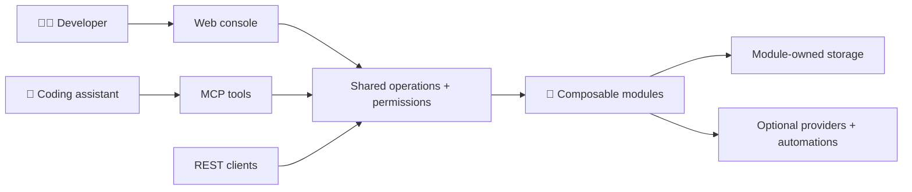
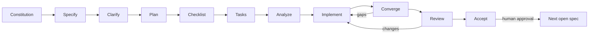

<p align="center">
  
</p>

<p align="center">
  <strong>Your platform. Your ingredients.</strong><br>
  A composable, self-hosted internal developer platform — built to fit your team, not the other way around.
</p>

<p align="center">
  <a href="LICENSE"></a>
  
  <a href="docs/master-spec-inventory.md"></a>
</p>

<p align="center">
  <a href="docs/product-vision.md">🌍 Vision</a> ·
  <a href="docs/architecture.md">🧩 Architecture</a> ·
  <a href="docs/master-spec-inventory.md">🗺️ Roadmap</a> ·
  <a href="CONTRIBUTING.md">🤝 Contribute</a>
</p>

## 🍽️ Meet Köfte

Developers deserve a clear, welcoming home for services, owners, resources and guarded automations. Platform teams deserve the freedom to assemble that experience from modules instead of maintaining a fork.

**Köfte is being designed for both.** Its planned interfaces share the same operations and permissions, whether you work in a browser, call an API, or use an MCP-enabled coding assistant.

| Ingredient | What we're working toward |
| --- | --- |
| 🧩 Deep composability | Modules contributing backend features, UI, resources, events, workflows, permissions and MCP tools |
| 🏠 Self-hosted freedom | A lightweight SQLite profile, PostgreSQL for shared installations, and first-class Kubernetes support |
| 🤖 Assistant-native access | Early authenticated MCP tools, not a privileged side door |
| ✨ Thoughtful experience | A fast, accessible Next.js console with clear loading, empty, error and permission states |
| 🔐 Explicit boundaries | Team-scoped authorization, audited actions and module-owned storage |

> [!IMPORTANT]
> **Bootstrap implementation is in progress, not a finished product.** A module-free .NET host, persistent local SQLite store, Next.js status page, local supervisor, owned PostgreSQL verification, guarded recovery and generated Development OpenAPI now exist. All ten local automated verification groups pass on macOS; spec **001** remains open for supported-target/CI and human accessibility/reference/contributor evidence. Nothing here claims feature acceptance, production readiness or MVP completion.

## 🧭 The shape of things to come



This is the **planned architecture**, not a diagram of implemented services. PostgreSQL uses a named schema per module; SQLite uses a physical file per module. Hoard, cloud providers and infrastructure engines stay optional.

## 🚀 Start here

1. Read the [product charter](docs/product-charter.md), [vision](docs/product-vision.md) and [architecture](docs/architecture.md).
2. Follow the [contributor workflow](CONTRIBUTING.md), [local bootstrap guide](docs/development/local-development.md) and [assistant/MCP setup](docs/development/assistant-tooling.md).
3. When ready to begin product work, invoke **`drive-speckit`**. Each invocation performs one stage and publishes its result on the **same branch and draft PR for that numbered feature**. No merges between steps; request human merge only after final review and explicit feature acceptance.

The constitution's initial v1.0.0 was human-merged; its [v2.0.0 workflow amendment](.specify/memory/constitution.md) records the human-directed [one-feature/one-branch correction](docs/adr/0001-feature-delivery-lifecycle.md). Spec **001 / specify** has a [draft specification](specs/001-repository-bootstrap/spec.md) and its [author quality checklist](specs/001-repository-bootstrap/checklists/requirements.md), generated from the exact [inventory prompt](docs/master-spec-inventory.md). **Clarify, plan, checklist, tasks and analyze are complete:** no material requirements ambiguity remained; the [implementation plan](specs/001-repository-bootstrap/plan.md), research, data model, HTTP/UI contracts and future validation guide define the bounded foundation. At the reviewer's explicit request, agent-assisted evaluation of the [requirements-quality checklist](specs/001-repository-bootstrap/checklists/quality.md) satisfied all 36 criteria with evidence and found no blocking requirements gap. The [64-task implementation list](specs/001-repository-bootstrap/tasks.md) maps all four stories, 17 functional requirements and six measurable outcomes to path-specific work, explicit dependencies and mandatory validation. The read-only [analysis](specs/001-repository-bootstrap/analysis.md) passed with 23/23 requirements/outcomes and 15/15 acceptance scenarios covered, no unmapped tasks and no actionable or constitutional findings. This is design/task coverage, not runtime proof.

**001 / implement is in progress.** The human approved [ADR 0002](docs/adr/0002-bootstrap-development-baseline.md). The [dependency review](docs/development/dependencies.md) records the resolved graph, compatibility corrections, licenses and provenance before adoption. The [implementation checkpoint](specs/001-repository-bootstrap/implementation.md) records the host/web foundations, real SQLite/HTTP checks, local startup/restart, initial browser/axe evidence and the human-directed .NET test-source correction. Work continues on the existing branch and [draft PR #4](https://github.com/Stonefly-Labs/Kofte/pull/4), without an intermediate merge. The full implementation and later review/acceptance gates remain open. **Installing a skill does not execute it.**



See [Spec Kit workflow and recovery](docs/development/spec-workflow.md) for stage gates, durable state and acceptance.

## 🗂️ Repository map

```text
.github/       Contributor templates, Copilot instructions, skills, agents and CI
.specify/      Existing Spec Kit templates/scripts and tracked driver progress
.vscode/       Shared editor MCP configuration
apps/web/      Minimal Next.js bootstrap page and fixed readiness adapter
src/           .NET host, local storage/configuration and health slice
modules/       Reserved for independently packaged reference modules
packages/      Bootstrap contract; UI/module SDK placeholders remain reserved
tests/         Dedicated .NET test projects, HTTP contract and browser tests
deploy/        Pinned disposable PostgreSQL Compose; Helm remains reserved
scripts/       Repository/dependency checks, supervisor, verifier and their tests
specs/         Numbered Spec Kit artifacts (not docs/specs/)
docs/          Product context, decisions, contributor guides and visual assets
```

Only the approved bootstrap boundaries are being implemented: one host, one web
app and their narrow shared contract. Modules, module/UI SDKs, workers and Helm
remain reserved. No application tables, fake identity, feature/admin/MCP routes
or module isolation are introduced by this foundation.

.NET test source belongs inside its dedicated test project under `tests/`,
never in production projects or linked from production vertical slices. Test
projects may mirror feature ownership; see the human-approved
[source ownership decision](docs/adr/0003-dotnet-test-source-ownership.md).

## 📚 Project bookshelf

| Read | Why |
| --- | --- |
| [Product charter](docs/product-charter.md) | Mandate, boundaries and required outcomes |
| [Product vision](docs/product-vision.md) | People, experience and long-term direction |
| [Technical architecture](docs/architecture.md) | Canonical architecture requirements and proposals |
| [Constitution](.specify/memory/constitution.md) | Product principles and delivery gates; v2.0.1 clarifies .NET test-source ownership |
| [Master spec inventory](docs/master-spec-inventory.md) | Ordered prompts; **001–024 MVP**, **025–038 post-MVP** |
| [Contributing](CONTRIBUTING.md) | Fresh branches, checks, commits, pushes and PR handoffs |
| [Local development](docs/development/local-development.md) | Current bootstrap startup, prerequisites, checks and remaining limits |
| [Assistant tooling](docs/development/assistant-tooling.md) | Microsoft Learn, Context7, Next.js, shadcn/ui and Playwright |
| [Spec workflow](docs/development/spec-workflow.md) | One-stage driver, checkpoints and human acceptance |
| [Architecture decisions](docs/adr/README.md) | Recording consequential choices without silently changing invariants |

The [older stack exploration](docs/kofte-technology-stack-architecture.md) is background, not authority over the charter, architecture or exact inventory scope.

## 🤝 Build it together

Open a focused [issue](https://github.com/Stonefly-Labs/Kofte/issues/new/choose), discuss a proposed slice, and keep each PR reviewable. Every change updates the README and related docs where behavior, setup or progress changes.

**Humans merge and close PRs. Assistants never do.**

## 📄 License

[MIT](LICENSE) · Stonefly Labs

<p align="center"><sub>Small core. Great modules. A platform with room for your recipe. 🧆</sub></p>
