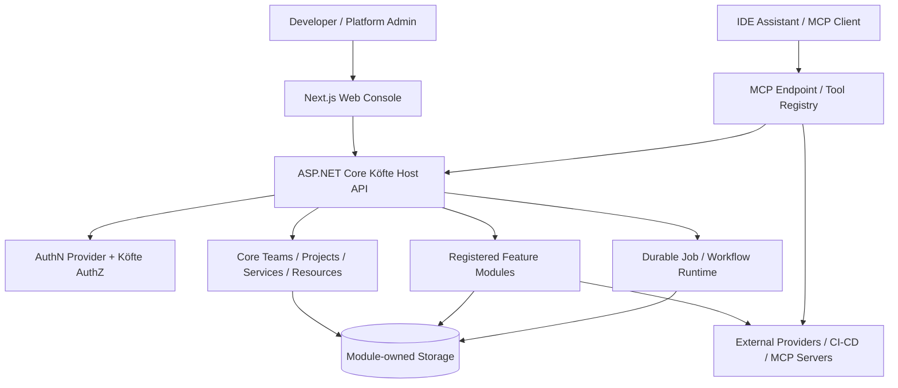
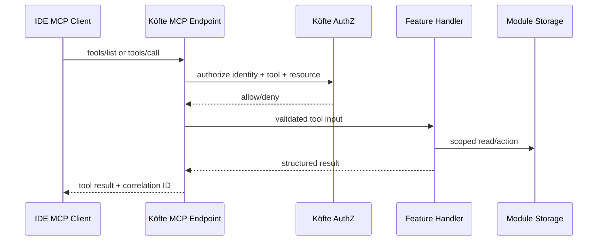

# Köfte — Technical Architecture

> **Status:** Proposed implementation architecture v0.1  
> **Date:** 2026-10-20  
> **Normative words:** **MUST** = agreed requirement; **SHOULD** = recommended design pending implementation validation; **MAY** = optional.  
> **Naming:** **Köfte** in human-facing UI/docs, `kofte` in technical identifiers.

## 1. Architecture goals

- A portable self-hosted **modular monolith** with deeply extensible module boundaries and paths to external providers/processes.
- **Vertical Slice Architecture (VSA)** for feature implementation inside the host and individual modules; isolate truly shared primitives and contracts.
- An early, secure **MCP server** that reuses domain operations and authorization rather than creating an alternate logic path.
- Minimal viable infrastructure for local/small users; PostgreSQL/Kubernetes-grade operations for team deployments.
- Module-owned data and migrations without name collisions or implied distributed transactions.
- A snappy, consistent, accessible UI with a documented extension model.

## 2. Context / logical components



The diagram is conceptual: MCP may be hosted in the same ASP.NET Core process; the jobs executor may start in that process or run as a separate worker using shared job contracts. The Next.js server and .NET API are separate runtime components.

## 3. Initial technology stack

The following is a **proposed stack** for implementation, not a claim that every package is already selected. Prefer current supported stable versions during repository initialization, pin versions, and confirm licensing before adoption.

| Layer               | Proposed choice                                                                           | Purpose / rationale                                           |
| ------------------- | ----------------------------------------------------------------------------------------- | ------------------------------------------------------------- |
| Core API            | ASP.NET Core (.NET current supported LTS), C#                                             | Mature hosting, middleware, DI, testing, performance          |
| Application style   | Modular monolith, VSA, minimal endpoints/route groups                                     | Independent slices without needless mediator abstraction      |
| Frontend            | Next.js App Router, React, TypeScript                                                     | Polished portal, SSR/server components where useful           |
| UI components       | Tailwind CSS, shadcn/ui, Radix primitives, Lucide icons                                   | Fast, accessible, customizable visual system                  |
| Frontend state/data | TanStack Query for interactive server state; Zod + React Hook Form for forms              | Optimistic UX, validation, consistent caching                 |
| Data                | EF Core with Npgsql and SQLite providers                                                  | Managed relational models/migrations, flexible deployment     |
| PostgreSQL          | Database with one dedicated **named schema per module**                                   | Ownership/isolation, migrations, permissions                  |
| SQLite              | One **database file per module**                                                          | Small installs with physically separated data                 |
| Realtime            | ASP.NET Core SignalR                                                                      | Provider-neutral push to UI; avoid mandatory Azure Web PubSub |
| Jobs                | Custom minimal persisted job abstractions built on hosted workers; evaluate library later | Durable states/retries without forcing heavy orchestrator     |
| Events              | In-process pub/sub abstraction, durable outbox when side effects require it               | Decoupled modules, future transport flexibility               |
| MCP                 | .NET MCP server SDK (verify stable package/API)                                           | Tools and resource discovery for assistants                   |
| AuthN               | ASP.NET Core Identity account management + local/OIDC authentication                       | Approved scope rework; no required identity vendor; development remains separate |
| AuthZ               | Central RBAC/permission service + resource/team scope                                     | Same policy for UI/API/jobs/MCP                               |
| Validation          | FluentValidation or equivalent permissively licensed validation                           | Validation local to each vertical slice                       |
| Telemetry           | OpenTelemetry, structured logging, health checks                                          | Vendor-neutral traces, logs, metrics                          |
| API contract        | OpenAPI/JSON Schema; typed client generation optional                                     | Stable external/SDK/module experience                         |
| Local orchestration | .NET Aspire or Docker Compose (assess lowest-friction path)                               | Reproducible multi-service development                        |
| Container/deploy    | OCI images, Helm/Kustomize templates for Kubernetes                                       | First-class portable K8s operation                            |
| CI / testing        | GitHub Actions, xUnit or equivalent, Playwright, Testcontainers                           | Contract, integration and UI verification                     |

**Dependency rule:** Do not introduce MediatR or commercially encumbered mediator/framework dependencies by default. Ordinary DI, direct handlers and small in-house dispatch contracts are sufficient. All dependency licenses should be reviewed in CI.

Spec 001's [human-approved bootstrap design](adr/0002-bootstrap-development-baseline.md)
and [plan](../specs/001-repository-bootstrap/plan.md) narrow these proposals for
the foundation: native local host/web processes, npm workspaces, SQLite and
disposable PostgreSQL verification, with no application tables or empty EF model.
Module-owned EF contexts/migrations remain mandatory when modules arrive.
The bootstrap's native host/web, SQLite store, disposable PostgreSQL fixtures,
guarded recovery and generated Development contract are now implemented;
see the [local guide](development/local-development.md) and
[actual evidence](../specs/001-repository-bootstrap/implementation.md).
Both supported targets have automated evidence; the human has confirmed the
manual/reference tasks. All 64 implementation tasks and the final local/CI
verification are evidenced.
[Convergence](../specs/001-repository-bootstrap/convergence.md) found no
actionable spec/plan/task/constitutional gaps and left the task list unchanged.
[Final review](../specs/001-repository-bootstrap/review.md) also passes:
independent code/test assessment found no acceptance defect, and a fresh complete
local gate passes all 170 named steps with assessed-head CI parity.
[Explicit human acceptance](../specs/001-repository-bootstrap/acceptance.md)
now completes spec 001's agreed bootstrap scope, retaining the documented
limitations. Its original PR is now human-merged with accepted evidence on main.
Spec 002 has a [draft requirements specification](../specs/002-platform-contracts/spec.md)
for minimal platform contracts and module identity; clarification is complete
with no material ambiguity or spec changes. Its [plan](../specs/002-platform-contracts/plan.md)
now proposes a minimal shared library, strict JSON/schema and bounded pure
validation with explicit SemVer compatibility. [ADR 0004](adr/0004-module-manifest-contract.md)
records the human-approved design choices.
Its [quality review](../specs/002-platform-contracts/checklists/quality.md)
now satisfies all 36 requirements-quality criteria after explicit reviewer
authorization, with no blocking gap. The subsequent explicit ADR 0004 approval
resolves that design gate; subsequent evidence and explicit requirement
amendments are tracked below. The [48 tasks](../specs/002-platform-contracts/tasks.md)
now order identity and compatibility components before the complete public
validation path, then safe correction and cross-cutting evidence. All requirements,
outcomes and scenarios are mapped. The read-only
[analysis](../specs/002-platform-contracts/analysis.md) passes with concrete coverage
of all 21 requirements/outcomes and 14 scenarios, no unmapped task and no
actionable or constitutional finding at its analyzed checkpoint.
The current [implementation](../specs/002-platform-contracts/implementation.md)
adds the pure platform library and test-owned author/host-facing consumers,
not a module loader or storage registry. Its
[author guide](../specs/002-platform-contracts/quickstart.md) is executable.
The human-directed ADR amendment accepts actual available-workstation/CI timing,
not a fixed Ubuntu/CPU/RAM profile. The subsequent author-guide amendment replaces
the manual timed exercise with automated guide/correction/retry proof.
The [T049 implementation increment](../specs/002-platform-contracts/implementation.md#convergence-remediation-t049)
closes the prior [convergence](../specs/002-platform-contracts/convergence.md)
public/repeated-corpus evidence gap: documented boundaries, ordered errors and
truncation now run 100 times per consumer per real culture. No parser defect
was exposed, and no production code, schema or architecture decision changed.
Follow-up [convergence](../specs/002-platform-contracts/convergence.md) now
passes with zero actionable gaps after assessing all 35 requirements/outcomes/
scenarios, twelve plan decisions, all 49 tasks and twelve principles. No task,
product code or architecture decision changes in that stage. The independent
[final review](../specs/002-platform-contracts/review.md) now also passes with
source/test evidence for all 35 requirements/outcomes/scenarios, twelve plan
decisions, 49 tasks and twelve principles, and no acceptance defect.
Fresh quality/unit/both-provider contracts pass 62 targeted steps; assessed-head
CI passes all eleven contexts and 177 product steps. No architecture or product
change is made by review.
[Explicit human acceptance](../specs/002-platform-contracts/acceptance.md)
now separately records feature 002's approval with its existing scope and
limitations. The original PR is now human-merged with accepted evidence on main;
no architecture change, new local all-suite or human-usability claim is made
by acceptance.
The host only gains a library project reference; its startup,
routes, stores and web console remain module-free.
Spec 003's [ADR 0005](adr/0005-module-storage-ownership.md) is now explicitly
human-approved for implementation. The
[implementation checkpoint](../specs/003-storage-registry/implementation.md)
adds reviewed EF/provider dependencies, a platform-local registry, immutable
assignments, marker-verified module schemas/files and real both-provider
registration/constraint/process-race evidence. Normal serving remains
module-free. The resumed implementation adds assigned model/history preflight,
actual killed-process recovery, explicit owner-bound abandoned-lock recovery,
admitted maintenance supervision and captured privacy checks. Migration physical
verification rejects unexpected tables/columns/defaults, missing primary keys,
secondary constraints/indexes, generated columns and views/routines/triggers.
The implementation checkpoint marked all 78 original tasks complete; its complete
local 200-step gate and eleven assessed-head CI contexts pass.
The subsequent [convergence](../specs/003-storage-registry/convergence.md)
finds two HIGH partial public-example gaps, not a demonstrated storage-engine
defect or changed architecture decision. T079-T080 require the promised public
three-restart/data retry and distinct-registered-ID collision examples; separate
integration tests already cover the core behavior. No product/test code or
approved design changes during convergence.
The [T079-T080 remediation](../specs/003-storage-registry/implementation.md#convergence-remediation-t079-t080)
now supplies those public observations: three fresh processes retain both exact
assignments and sentinels; the forced registered-owner UNIQUE conflict preserves
assignment/data/inventory and creates no contender allocation. Standalone/`all`
harnesses require measured evidence, and the unowned-target refusal remains.
Only the test-support assembly gains access to the existing internal allocator
seam; no public override, runtime storage rule or dependency is added.
All 80 tasks are evidenced.
The [follow-up convergence](../specs/003-storage-registry/convergence.md) now
passes with zero actionable gaps across all 40 requirements/outcomes/scenarios,
fourteen plan decisions, 80 tasks and twelve principles. It verifies both
public-example findings are closed and leaves tasks, product/test source and
architecture decisions unchanged. Actual assessed-head CI passes eleven contexts
and 200 product steps. Review is next on the same draft PR, followed separately
by explicit human acceptance; convergence does neither and requests no merge.
The subsequent [final review](../specs/003-storage-registry/review.md) records
**changes** for one MEDIUM regression-evidence gap, not a demonstrated runtime
defect or changed architecture decision. T081 must prove that a changed allocator
is not called for a persisted owner and that a persisted no-storage owner cannot
become relational, preserving exact assignments/data/revisions/inventory.
All 80 historical task markers and prior reports are retained; public F1/F2
remain closed. Fresh quality/unit/both-provider integration/recovery/contract/
privacy checks pass 157 targeted steps and actual assessed-head CI passes all
eleven contexts/200 product steps, without supplying the absent regressions.
That review selected implement without a new design approval or merge.
The [T081 regressions](../specs/003-storage-registry/implementation.md#final-review-remediation-t081)
now pass all four real-provider cases, proving zero allocator calls for persisted
owners and immutable no-storage declarations, with exact assignment/data/revision/
inventory preservation. Controlled mutations demonstrate failure detection.
All 81 tasks are evidenced; quality/unit/integration gates pass 46 targeted steps
after an unchanged PostgreSQL rerun of two initial deadline failures. No runtime,
API, dependency or architecture change is introduced.
The [current convergence](../specs/003-storage-registry/convergence.md) now passes
after checking all 40 requirements/outcomes/scenarios, fourteen plan decisions,
81 tasks and twelve principles against actual source/assertions. R1/T081 and
prior public F1/F2 are closed, with zero actionable gaps and no appended task.
Tasks, product/test source, approved design and historical review remain
unchanged. That convergence selected review on the same draft PR.
The [follow-up final review](../specs/003-storage-registry/review.md) now records
**changes** for one MEDIUM implementation finding R2: explicit registry-upgrade
mutations and rejected boundaries omit required correlated storage records.
Existing CLI success/generic failure summaries do not supply the direct API's
complete operation evidence. R1/T081 and prior public F1/F2 are closed.
Exactly T082 is appended for bounded private telemetry/CLI projection and real
both-provider captures, without changing approved architecture, APIs, dependencies,
code or historical task markers. No storage-isolation failure or new design
decision is demonstrated. That review selected implement.
The [T082 increment](../specs/003-storage-registry/implementation.md#final-review-remediation-t082)
now reuses assignment-independent diagnostic emission for explicit upgrades and
failed acquisition. Records include fixed guidance and truthful durability,
without changing `IStorageMaintenance` or manufacturing a module result.
The supervisor maps allowlisted worker exit identities into safe operation
records; raw output remains drained. Both-provider capture/CLI regressions cover
commits, idempotence, boundary refusals and sanitized uncertain failures.
All 82 tasks were evidenced at that implementation checkpoint, which selected
follow-up converge. The [current assessment](../specs/003-storage-registry/convergence.md)
now records **gaps**: R2/T082 and prior T079-T081 are closed, but the public
recovery-set inspection/verification/manifest-write entry points bypass correlated
operation records. A rejected inspection reproduces zero records/spans/counters.
One MEDIUM partial finding F3 appends T083 for the existing FR-014 diagnostic
obligation and capture regressions, not a new durable audit service or design.
That checkpoint selected implement on the same draft PR. All prior task bytes,
product/test code, approved architecture, dependencies and historical reports
remain unchanged; no feature acceptance or intermediate merge is requested.
The [T083 increment](../specs/003-storage-registry/implementation.md#convergence-remediation-t083)
now observes recovery boundaries through the shared emitter without a fabricated
module result, assignment or durable audit runtime. Provider labels come from
trusted installations or fully validated metadata; failures before either use
bounded `unknown`. Manifest durability reflects actual exclusive creation,
completed serialization/flush/close and possible partial writes. Existing
authority, exception contracts, recovery rules and dependencies are unchanged.
All 83 tasks are evidenced with real-provider capture regressions.
That implementation checkpoint selected follow-up converge.
The [convergence after T083](../specs/003-storage-registry/convergence.md) now
**passes** across all 40 requirements/outcomes/scenarios, fourteen plan decisions,
83 tasks and twelve principles. Actual recovery records/captures close F3;
prior T079-T082 remain closed, with zero actionable gaps and no appended task.
Tasks, product/test source, approved architecture, historical review and reviewer
checklists remain unchanged. **Review is next** on the same draft PR, followed
separately by explicit human acceptance; no intermediate merge is requested.
The [final review after T083](../specs/003-storage-registry/review.md) now
**passes** with source/assertion coverage of all 40 requirements/outcomes/
scenarios, fourteen plan decisions, 83 tasks and twelve principles.
F1/F2, R1/R2 and F3 are closed; no defect, remediation task or unresolved
within-scope design decision remains. Tasks, product/test source, approved
architecture and reviewer-owned checklists are unchanged; previous review
evidence is preserved verbatim. **Explicit human acceptance of numbered
feature 003 is next**, separately on the same draft PR. Review neither
accepts the feature nor requests merge or starts 004.
The [explicit human acceptance](../specs/003-storage-registry/acceptance.md)
now records **"this human accesspts 003"** for feature 003 and its documented
scope/limits. No architecture, product/test source, dependency, task, reviewed
checklist or prior evidence changes. Acceptance adds no product measurement,
production-readiness claim or later-scope waiver. The same
[PR #6](https://github.com/Stonefly-Labs/Kofte/pull/6) was human-merged.
Its accepted ledger and all five acceptance hashes were verified on updated
main before 004 began; acceptance itself started no new feature.

**004 / specify, clarify, plan, checklist, tasks and analyze are complete** on `feature/004-module-lifecycle`.
The [draft requirements](../specs/004-module-lifecycle/spec.md) and
[16/16 author checklist](../specs/004-module-lifecycle/checklists/requirements.md)
define trusted module composition, dependency/configuration/contribution
preflight, ordered initialization/migrations, data-preserving restart-controlled
disable/re-enable and honest health/failure observations. They preserve accepted
002/003 contracts and exclude public lifecycle administration, hostile-code
isolation, hot-unload and later extension runtimes. Clarification found all ten
requirements categories clear, with zero questions and no spec/checklist changes;
no design choice or human answer was invented. The
[plan](../specs/004-module-lifecycle/plan.md) and
[Accepted ADR 0006](adr/0006-module-composition-lifecycle.md) now define explicit
compiled discovery, stable bounded whole-set preflight, native DI and separate
stopped preparation versus supervised serving. Assigned migrations/privilege
separation and exact stores remain accepted 003; no anonymous module route or
later capability runtime is added. Current-attempt private health drives only
the existing aggregate readiness contract. Both constitutional design gates
pass. The human's explicit **"yeah approved"** resolves ADR 0006's design gate;
dependency-edge adoption and actual process/provider/privacy proof are separate
implementation gates. Historical planning artifacts and ledger evidence are unchanged.
The [quality checklist](../specs/004-module-lifecycle/checklists/quality.md)
now satisfies **36/36 requirements-quality criteria** covering
composition/lifecycle, storage/recovery, authority, privacy and retained
interfaces, evaluated with per-item evidence under the reviewer's explicit
request. No blocking requirements gap, new human decision or design change
was found. Spec, plan and 16/16 author checklist remain unchanged.
The [80 implementation tasks](../specs/004-module-lifecycle/tasks.md) order
US2 whole-set preflight before US1 startup, then US3 stopped preparation,
US4 exact preservation and US5 current health/safe failure evidence.
They trace all 20 scenarios, 20 requirements, six outcomes and R1-R12
decisions to concrete paths/prerequisites, real provider/process/public
assertions and retained full gates without changing the approved architecture
or reviewer-owned requirements markers.
The read-only [analysis](../specs/004-module-lifecycle/analysis.md) passes:
all 26 requirements/outcomes, 20 scenarios, 80 tasks and twelve plan decisions
have concrete coverage, with 118 acyclic dependency edges and no actionable
or constitutional issue. Both contracts, approved design and reviewed
checklists remain unchanged. **The original implementation completed all 80 tasks** on this same branch and
[draft PR #7](https://github.com/Stonefly-Labs/Kofte/pull/7), not acceptance
or a merge. The [implementation evidence](../specs/004-module-lifecycle/implementation.md)
records the separately reviewed DI edge and focused foundation checks. A
non-authoritative model boundary permits new-owner structural inspection
without an assignment or store opener; actual bindings and migrations retain
accepted 003 authority. Actual stopped preparation now performs all-enabled
preflight before owner-local writes in dependency order. Ordinary serving uses
runtime credentials, verifies current stores/history and never provisions,
migrates or rewrites migration revisions. Per-owner progress preserves original
003 correlation/durability; a later interrupted owner does not roll back an
earlier commit or authorize automatic replay. The public relational example
passes on both providers, including actual later-owner interruption, unchanged
automatic-retry refusal and explicit accepted recovery before a fresh attempt.
Complete-set recovery includes disabled owners and refuses legacy platform-only
operations. Restoring a deliberately selected older set into a fresh owned
target is an explicit data-loss decision, not automatic compensation. The
original source is retained. Three complete disabled/re-enabled process cycles
per provider now preserve exact original assignments/revisions/data/history and
complete unrelated state; disabled callbacks remain zero. Invalid dependent
selection refuses unchanged, and a separately prepared single-owner additive
release changes only that owner's target. Five explicit corrections now require
fresh attempts, exact retained stores and accepted recovery for uncertain writes.
Immutable health samples propagate failed/unknown/degraded prerequisites without
hiding independent roots; publication checks the same immutable state it commits.
Anonymous health reads snapshots without author callbacks and retains its schema.
Supervised timeout/cleanup preserves real owner/stage, withdraws readiness and
verifies owned exits rather than running concurrent abandoned cleanup. Losing a
serving lease never reacquires it. Private records/transition events/spans/metrics
retain safe codes/guidance and original storage durability, never raw settings,
credentials, paths, exception/output text or caller baggage. Trusted code remains
unsandboxed; no durable audit, lifecycle administration or general descendant
termination guarantee is introduced. All public scenarios are implemented;
all 80 tasks, ten complete local suite/provider reports and 286 steps are
evidenced at assessed code head `267efc8`. Its eleven CI contexts and 286
product steps also pass, including every public guide command and strict
observation. The [final reconciliation](../specs/004-module-lifecycle/implementation.md#final-complete-gate-and-implementation-handoff)
retains earlier failed evidence and fixture-only administrative-budget/
contention-workload repairs. No product bound, retry rule, assertion or floor
is relaxed. That checkpoint selected convergence, not acceptance or merge.

The historical [004 convergence assessment](../specs/004-module-lifecycle/convergence.md)
found one HIGH partial gap: disabled snapshots never reached private operator
output. The [T081 implementation](../specs/004-module-lifecycle/implementation.md#convergence-remediation-t081)
now projects that existing model after successful composition resolution,
emitting one bounded `discovered / disabled / composition_disabled` record per
explicitly disabled or omitted owner. Parent and worker copy the admitted
enabled-owner set and reject contradictory disabled frames. Version 1, frame/
record limits, fixed guidance, owner allowlists and anonymous aggregate schema
are unchanged; no new storage/configuration/runtime authority is introduced.
Actual both-provider public hosts prove fresh explicit/omitted observations
and zero disabled effects. All 81 then-existing tasks are implemented; that
checkpoint selected follow-up convergence on the same draft PR. Historical
reports, approved architecture/dependencies and reviewer-owned checklists are
preserved; review and explicit human acceptance remain later gates.

The [follow-up assessment](../specs/004-module-lifecycle/convergence.md)
closes F1/T081, but records HIGH F2: contribution local IDs admit 128 characters,
while the host prefixes the owner and supplies that combined ID to a public
dependency binding capped at 128. Valid input therefore fails activation;
T082 must reconcile composition without silently narrowing approved inputs.
MEDIUM F3 requires establishing the cause of repeated unexpected normal-stop
cleanup failures, not assuming a product timeout or relaxing fail-closed
semantics. Broad integration passes 102/104; unchanged isolation passes 5/5.
Exactly T082-T083 were appended, selecting implement on draft PR #7.
This assessment changes no architecture decision, source or approved contract.

The [T082-T083 implementation](../specs/004-module-lifecycle/implementation.md#convergence-remediation-t082-t083)
now admits the exact owner prefix plus the accepted 128-character local service
name (up to 382 characters for a 253-character owner), retaining legacy explicit
binding IDs up to 128. Ownership, versioning, collision safety and input bounds
are unchanged; identities are neither truncated nor hashed. The independent
public example requires its exact boundary binding and actual Start/readiness.
Incomplete HTTP requests deterministically reproduced normal-stop failures on
both providers. A 500-ms internal HTTP shutdown budget leaves time to abort/
finish draining inside the unchanged one-second outer action; total stop
remains 15 seconds. Four fixed private `stopping / incomplete` codes identify
infrastructure cleanup boundaries without introducing raw details or new
fields. Ownerless `cleanup` remains terminal, and lost-authority disposal still
refuses success with uncertain durability. All 83 then-existing tasks are
implemented; that checkpoint selected follow-up converge. Historical failures
remain recorded without claiming that this reproduction explains each occurrence.
No new architecture decision,
dependency, public endpoint or privilege is introduced.

The [convergence after T082-T083](../specs/004-module-lifecycle/convergence.md) closes
the disabled-state and binding-name findings, but retains two partial gaps.
HIGH F4 shows 65 prerequisite service exports or 129 global executable
exports fail after accepted resolution; complete runtime counts must match
the approved 128-per-owner/1,024-total contribution bounds. MEDIUM F3 remains
open: two fresh normal paths fail host disposal despite passing incomplete-
request HTTP-stop regressions. Only T084-T085 are appended; no product,
contract, dependency, authority or approved architecture is changed.
That checkpoint selected implement on the same draft PR #7; it did not
establish or silently attribute the disposal cause to scheduling.

The [T084-T085 increment](../specs/004-module-lifecycle/implementation.md#convergence-remediation-t084-t085)
preserves the existing contribution bounds through executable registration
and activation: 128 per owner, 1,024 enabled total and up to 1,024 complete
copied prerequisite service bindings, independently of module-dependency count.
An actual-builder regression proves that unused default JSON reload watchers
survived configuration-source clearing. The composed host now disables reload
before slim-builder construction, retaining the admitted snapshot and avoiding
that unnecessary file-provider disposal work. No polling fallback, widened
budget, DI ownership change or success-shaped cleanup is introduced.
The corrected both-provider composition selection passes 106/106; all failed
evidence and complete-gate reconciliation are retained. Follow-up convergence,
review and explicit human acceptance remain later separate gates.

The [convergence after T084-T085](../specs/004-module-lifecycle/convergence.md)
now **passes**: all 46 requirements/outcomes/scenarios, twelve plan decisions,
85 tasks and twelve principles were assessed with zero actionable gaps.
All F1-F4 findings are closed; task bytes, approved architecture, reviewed
checklists and product/test code are unchanged. **Review is next**, separately
on the same draft PR #7, before explicit human acceptance; no new architecture,
readiness or intermediate merge is introduced.

The subsequent [final review](../specs/004-module-lifecycle/review.md) records
**changes** for one HIGH implementation defect R1: diagnostic prerequisite
metadata from disabled deployments incorrectly shares the 1,024 enabled-edge
limit. Valid catalogs can contain up to 2,048 distinct disabled prerequisites;
actual validate/serve refuses before worker admission despite accepted public
resolution. Exactly T086 is appended to reconcile bounded parent/worker
metadata without weakening graph, identity or framing rules. **Implement is
next** on the same draft PR #7. No approved architecture, product/test source,
historical finding closure or human acceptance is changed by this review.

The [T086 implementation](../specs/004-module-lifecycle/implementation.md#final-review-remediation-t086)
retains the existing shared parent/worker all-catalog prerequisite collection
and corrects its copied diagnostic allowlist to the derived 32-by-64 maximum:
2,048 identities, refusing the 2,049th without unbounded enumeration.
This is metadata, not the enabled graph; its 1,024-edge limit and all owner,
dependency, frame and related-identity restrictions are unchanged.
Real both-provider boundary boots require no disabled callback/allocation,
usable readiness, exact disabled observations, unchanged inventory and verified
clean exit. All eleven code-head CI contexts pass. A separate local complete-gate
PostgreSQL migration-interruption failure is retained without a causal
diagnosis. The human subsequently directed
[fact documentation and deferred investigation](../specs/004-module-lifecycle/implementation.md#human-directed-deferral-and-implementation-handoff)
as non-blocking for this implementation checkpoint, after reviewing eight passes
and one failure. This changes no architecture, test assertion or recorded result.
T086 is complete; converge is next on draft PR #7, before final review and
explicit human acceptance.

The [convergence after T086](../specs/004-module-lifecycle/convergence.md)
now passes across all 46 requirements/outcomes/scenarios, twelve decisions,
86 tasks and twelve principles, with no new actionable gap. Review R1 and
prior F1-F4 are closed; approved architecture, tasks and product/test source
are unchanged. The separately deferred PostgreSQL observation remains
undiagnosed, and the failed local complete attempt remains failed.
**Review is next** on the same draft PR #7; no later gate or human acceptance
is waived, and no intermediate merge is requested.

The subsequent [final review after T086](../specs/004-module-lifecycle/review.md)
passes across all 46 requirements/outcomes/scenarios, twelve design decisions,
86 tasks and twelve principles. R1/T086 and prior F1-F4 are closed, with no new
implementation defect, task or architecture change. The undiagnosed
human-deferred PostgreSQL observation and failed/interrupted local complete
attempt remain explicit limitations, not a full-gate pass or release waiver.
**Explicit human acceptance of numbered feature 004 is next**, separately on
the same draft PR #7 with those limits disclosed. No readiness or intermediate
merge is requested.

The [explicit human acceptance](../specs/004-module-lifecycle/acceptance.md)
now records **"bro this human fugging accepts"** for numbered feature 004
after that passing review, with its scope and deferred failed-check limitation
retained. No architecture, product/test source or reviewed evidence changes.
The local complete attempt stays failed and undiagnosed; acceptance is not
a release waiver. The same PR #7 was returned to draft after a distinct SQLite
CI boot-theory failure. The
[follow-up record](../specs/004-module-lifecycle/implementation.md#post-acceptance-sqlite-ci-failure-and-diagnostic-correction)
preserves the unknown cause and unchanged local passes; only bounded verifier
diagnostics change, not product architecture or behavior. The
[full-matrix follow-up](../specs/004-module-lifecycle/implementation.md#full-matrix-ci-follow-up)
removes duplicate integration execution while retaining every case and deadline.
That historical handoff required all eleven latest-head checks to pass,
not one passing provider job. PR #7 is now human-merged; its accepted ledger
and all five acceptance artifact hashes were verified on updated main before
005 began. Historical failed checks and undiagnosed causes remain unchanged.

**005 / implement is complete after all 100 tasks, not an accepted feature**, on
`feature/005-authentication-bootstrap`. The
[implementation checkpoint](../specs/005-authentication-bootstrap/implementation.md)
retains exact results and historical failures. The
[runtime guide](../specs/005-authentication-bootstrap/quickstart.md) now describes
delivered OIDC/Development sessions, nomination and stopped recovery commands.
Designation does not grant module permissions; 006–009/022–024 remain future
work. All nine public recipes individually and `all` now pass on each provider,
with exact observations and owned cleanup. Local/Linux Chromium, focused
privacy/accessibility and strict browser completeness are qualified. Final
dependency/contract reconciliation and fresh zero-finding audits pass;
T097–T100 join the actual passing full hosted command, all ten real PR product
contexts/repository checks and complete requirement/assertion traceability.
Final complete-command execution is hosted Ubuntu, separately from the ten-job
matrix; interrupted Mac attempts are not a final macOS qualification. Placement
does not change any product/test deadline or architectural boundary.
Identity remains host-owned in platform format 2, never module tables or a
second authentication authority in Next. Only the immutable actor-v1 crosses
the module boundary. OIDC requires exact HTTPS ingress/provider/network trust;
forwarded headers do not establish trust. Private keys remain outside ordinary
complete-set artifacts. Restore quarantines the copy until explicit stopped
manifest-bound reconciliation and fresh keys; no OS-copy fencing, rollback-proof
administrator history or cross-module atomicity is promised. See the delivered
[operator contract](../specs/005-authentication-bootstrap/contracts/operator-v1.md)
and [local guide](development/local-development.md) for session/key overlap,
retention/capacity, nomination and IdP-loss limits. Approval of ADR 0007 is not
feature acceptance. The
[convergence assessment](../specs/005-authentication-bootstrap/convergence.md)
now passes across all 51 requirements/outcomes/scenarios, twelve plan decisions,
100 tasks and twelve principles with zero actionable gaps. No task, product,
test, dependency or architecture decision changes. Actual complete/current-head
CI reports each pass the same 313 named steps at that historical checkpoint.
The subsequent [final review](../specs/005-authentication-bootstrap/review.md)
requires **changes**: the OIDC backchannel checks configured networks but
omits the promised forbidden-address rule for resolved/connected destinations.
A separate current SQLite recovery enrollment setup returns 503 before key
damage; its cause is not diagnosed. Run `41098819181` is not green.
Exactly T101-T103 are appended for the existing-policy correction, diagnosis
and changed-source qualification. No architecture decision, product/test code,
original task marker or historical report changes in this review stage.
That review selected implement; the subsequent
[scope amendment](adr/0007-authentication-bootstrap-boundary.md#human-approved-scope-amendment-local-accounts-and-first-login-ownership)
now pauses continuation for ASP.NET Core Identity, production local/OIDC
accounts and first-login ownership with owner-led onboarding/RBAC.
One-time installation setup-token admission and the 005/006 delivery boundary
are now human-approved. The rewritten spec covers 005 account/authentication/
initial-Owner mechanics; existing 006 delivers invitations/user administration/
teams/RBAC. Clarification finds all ten categories Clear, with zero questions,
unchanged spec and 16/16 author criteria. The [revised plan](../specs/005-authentication-bootstrap/plan.md)
now proposes native Identity store integration, versioned contracts and
format-3 migration/recovery. Design/changed quality review, task reconciliation
and analysis still block implementation. Existing reviewer/runtime evidence does
not certify the amended semantics. The same PR remains draft,
not accepted or ready to merge.

The earlier implementation increments below retain the source/signature
investigation and record the adopted maintained
OIDC dependency, independent test issuer/ownership/corpora, strict static
configuration and public actor-v1. Actor identity is immutable and carries
no credential, database handle or permission grant. Parsing admits only the
documented configuration modes and private bounded references, with a
trust digest excluding display text and rotatable secret material.
The stopped, caller-transaction-owned migration now evolves format-1 constraints
and creates all eight identity tables without editing migration 1 or changing
module assignments/revisions/history/data. Frozen OID-independent native-catalog
fingerprints verify actual v1/v2 physical definitions, including constraints,
collations, indexes, triggers, routines, defaults and generated objects.
Existing reconciliation/composition inventory consumers share that verifier.
Recovery-v1 is not broadened to accept format 2.
The deadline integration issue is resolved for identity without changing
legacy migration execution: an owned SQLite native-handle path avoids the
provider's uncancellable integer-timeout retry loop, checks VM progress and
retries only documented known-not-committed boundaries. PostgreSQL uses
cancellable async work and unpooled connection closure. Both share the clipped
original budget with 50 ms reserved for cleanup, not added to the deadline.
Metadata/admission uses the normal host lease and an immediate SQLite write
transaction or PostgreSQL metadata row lock. PostgreSQL verifies the held
host backend's shared lock from the independent operation connection, never
executing concurrent requests on the borrowed lease connection. Checked security
revisions, UTC windows, hashed keys, exact rate/capacity refusal and 128-row
pruning leave module revisions untouched. Real-provider regressions cover
contention, rollback, overflow, foreign/lost authority and concurrent quotas.
Transactional events share owner commits/revisions, immutable installation
retention, bounded session-event pruning and exact capacity refusal.
Persistent keys bind installation/mode/purpose, verify owner-only artifacts and
require certificate encryption in OIDC mode; serving never creates lost rings.
Admitted stopped prepare/reconcile/revoke commands reuse exclusive maintenance
authority, initialize disabled bootstrap and preserve mappings/consumed
designation while invalidating sessions/attempts/pending authority.
Database and key-file preparation are explicitly not a distributed transaction.
PostgreSQL constraint fingerprints now use the server's parenthesis-normalizing
deparser, preserving full definitions across real dump/restore without dropping
checks or changing frozen migration-1 bytes.
Shared exact-route/default-deny/CSRF components and fixed private diagnostics
now have component/operator evidence. Identity
composition records remain an internal strict framed union, never new Platform
identity/lifecycle payload. Operator projection waits for verified child exit
and cleanup; a lost acknowledgement is uncertain, not success.
T021 shares configuration and read-only prepared
format/trust/key validation across empty and composed serving. It reuses their
actual normal host authority and installs the same services, persistent key
provider, request boundaries and private diagnostics. Valid older formats
require explicit stopped preparation; startup never repairs keys or contacts
discovery and refuses restored-copy quarantine. Foundation units and both-provider
storage/startup/stop/privacy gates pass with preserved snapshots. The actual
empty/composed stack also passes browser warm starts under unchanged envelopes.
Recorded initial failures and the controlled deadline-test profile remain
limitations of that evidence. Exact user mapping now runs inside the existing
owner transaction with creation evidence, strict key/profile bounds, finite
capacity and startup/maintenance correspondence validation. Real-store races,
rollback and fresh owner processes preserve IDs/designation across acknowledged
trust/mode changes; HTTP/session orchestration remains separate work.
Maintained native OIDC configuration now enforces confidential code+PKCE,
exact signed RS256 evidence, protected state/nonce and an explicitly bounded
HTTPS/DNS/peer/response/cache backchannel. Sixty-six real protocol,
transport and issuer cases pass. This is a pre-session validation seam:
the product hosts do not yet register an OIDC login route, and the test host
intercepts only after the native handler completes all protocol validation.
It cannot establish a local session or trusted actor.
Durable attempts now share the caller's existing owner mutation, including
compare-and-consume and rollback; they never commit independently. Quotas are
256 pending/installation and eight/browser, with five-minute expiry and
at-most-128-row cleanup. Mode/trust/epoch and browser digest must still match.
Native protected properties carry only the local binding; durable return paths
remain authoritative. Both-provider races and protected-state roundtrips pass,
but actual product login routes remain dependent work.
The validated-login coordinator now maps the exact identity, consumes its
attempt and persists the protected minimal session plus required events in one
owner commit. A private request-local one-shot bridge returns only that known
committed reference; framework storage never creates a second transaction.
Every retrieval verifies current stored user/mode/epoch/designation and renews
idle expiry only within the fixed absolute limit. Terminal revocation cannot
be resurrected; per-user/global session overflow refuses without eviction.
Native cookie sliding renewal stays disabled, and the session cookie manager
withholds pre-login cookies on new-login paths so framework sign-in cannot
renew/reuse an older reference.
Thirty both-provider native-handler contracts cover commit/publication/crash
boundaries, references, expiry/revocation and capacities. They use an owned
test host. T031/T032 now register product browser-context, protected
login/callback and self-only `/me` in both serving paths. Native authentication
runs after the exact route/binding/budget boundary, not automatically before it;
health suppresses session retrieval without relocating the authentication
middleware. Only the validated durable view populates the read-only scoped actor.
Exact Origin/framework CSRF, private browser binding, rate/cookie/target bounds,
canonical returns and safe errors/headers apply before protected effects.
Fresh profiles/designation, revocation and corrupt protection are tested;
initial designation still grants no unrelated action. Additive generated
identity contracts preserve every accepted bootstrap operation/component.
The combined gate passes 52 both-provider native/session/route/API cases.
Independent adapter/configuration tests pass 51 cases. T034 now passes all
sixteen actual owned host/Next parity observations and verified cleanup:
a post-exit `EPERM` requires a zero-signal kernel confirmation that the
entire group is absent; present/unverifiable descendants still fail.
T035/T036 deliver `/identity` as a non-personal, no-store shell with deliberate
sign-in, fresh token pairs, bounded verification, escaped display and
stale-state clearing. All 98 web units, lint/types/build pass. The UI's
sign-in Server Action forwards actual Origin, credential evidence and the
explicit CSRF pair through the same bounded fixed-backend adapter; validated
cookies are published before the framework redirect. This is transport, not
another authentication authority or a contract relaxation. A real native
form under required `no-referrer` produced `Origin: null`, which remains
refused. Actual Ubuntu login/trust browser recipes pass on both stores at
`6be0ee8`, with ordinary TLS and exact-group cleanup verification. Local
macOS browser lifecycle/cleanup still fails. The corrected local protocol
matrix passes 123/123; mapping/restart passes 20/20, retaining the intervening
SQLite readiness failure and unknown cause. Both complete provider integration
jobs and the four actual browser recipes pass at `2f56f35`, completing US1.
Broader composition-contract/recovery CI failures remain. Private source-known
host diagnostics now survive isolated propagation; a reproduced comparison
bug admits only the exact additional private XML-report flags, not arbitrary
command changes. Enrollment, sign-out, development sessions and identity
recovery remain (60 unchecked tasks). Published `f89c1ec` passed all eleven CI
contexts; no feature acceptance or current complete gate is claimed.

The completed specify-through-analyze history below is retained on
`feature/005-authentication-bootstrap`. Its
[draft requirements](../specs/005-authentication-bootstrap/spec.md) define
host-owned production OIDC identity, explicit development limits, stable user
mapping, one-time nominated first-admin enrollment and shared browser/API
boundaries. The [author checklist](../specs/005-authentication-bootstrap/checklists/requirements.md)
satisfies 16/16 criteria. Five stories, 22 scenarios, 22 requirements and seven
outcomes require real-provider/protocol/browser/privacy evidence later.
Clarification found all ten requirements categories clear, with zero questions
and no spec/checklist changes; all 16 author criteria remain satisfied.
The [coverage assessment](development/spec-workflow.md#invocation-and-current-progress)
preserves the unchanged clarification evidence. The
[plan](../specs/005-authentication-bootstrap/plan.md) and
[ADR 0007](adr/0007-authentication-bootstrap-boundary.md) now define
confidential OIDC code+PKCE, durable server-side cookie tickets, exact same-origin
Next adapters/optional direct ingress, actor-v1 and nominated one-time enrollment.
Host-owned format-2 SQL/history and recovery-v2 deliberately extend the strict
accepted platform inventory; module allocation/EF ownership and offline
privilege boundaries remain unchanged. Restore quarantines security state and
invalidates sessions, never automatically reopens bootstrap.
Finite trust/egress/state budgets, protected key persistence, minimal durable
records, accessible UI and independent both-provider/protocol/consumer/browser/
privacy evidence are specified, not implemented. Both constitutional design
gates pass. ADR 0007 is now **human-approved for implementation** by the explicit
decision **"ok, I approve it"**; historical planning artifacts/ledger are unchanged
and no stage is executed by recording approval. The new OIDC dependency closure
still needs actual adoption review. Granular authorization,
MCP and general audit administration remain 006/007/009. No product code/package,
tasks, runtime proof or feature acceptance is introduced by planning.
The subsequent [requirements-quality checklist](../specs/005-authentication-bootstrap/checklists/quality.md)
now satisfies 36/36 criteria after explicitly requested assisted review, with
per-item evidence for identity/access, enrollment, host/module storage/recovery,
UX and operability. No unresolved requirements gap, constitutional conflict
or new human decision needs attention. The review changes no architecture
decision or planning evidence and resolves the earlier checklist block.
The [100 tasks](../specs/005-authentication-bootstrap/tasks.md)
map every requirement/outcome/scenario and all twelve design decisions to
path-specific implementation and independent evidence, with explicit acyclic
dependencies and model constraints. They retain exact platform/recovery versions,
module ownership, default denial, separate stopped initialization and truthful
filesystem/database partial effects; no new architecture decision is made.
The read-only [analysis](../specs/005-authentication-bootstrap/analysis.md)
passes with concrete coverage of all 29 requirements/outcomes and 22 scenarios,
100 mapped tasks and 242 acyclic dependency edges. No actionable or constitutional
finding remains at that analysis checkpoint; assessed inputs/reviewer markers
were unchanged. Only prerequisite-evidence T001 is now checked. The same draft
PR #8 retains the blocked implementation, not an intermediate merge, runtime
result, new architecture decision or feature acceptance.

The following paragraphs
preserve the earlier design-stage history; their Proposed/unstarted statements
do not describe current implementation progress.

Spec 003's [draft specification](../specs/003-storage-registry/spec.md) now
defines the next storage slice: immutable registry ownership, concurrent
collision-safe allocation, isolated module tables/history and crash/recovery
semantics. Clarification now finds all ten ambiguity categories clear, with
zero questions and no spec/checklist changes; the author checklist remains
16/16. Its [plan](../specs/003-storage-registry/plan.md) now proposes immutable
allocator-v1 keys with actual UNIQUE/concurrency checks, verified ownership
markers, assigned EF model/history/migration binding and explicit stopped
complete-set recovery. [Proposed ADR 0005](adr/0005-module-storage-ownership.md)
separates offline PostgreSQL provisioning from the runtime credential: database
CREATE remains denied to the host, and existing owned fixture/runtime checks
remain intact. SQLite retains separate private files and the existing
stopped-host maintenance lease. Bootstrap upgrade is explicit; unsafe legacy
platform-only recovery/reset will be refused once registry/module data exists.
Both constitutional design gates pass; no package or code is adopted.
The [quality checklist](../specs/003-storage-registry/checklists/quality.md)
now passes all 36 requirements-quality criteria under explicit reviewer
authorization, with per-item evidence and no blocking gap or constitutional
conflict. This does not approve ADR 0005 or prove the design: human ADR approval,
dependency adoption and actual both-provider proof remain future gates.
The [78-task list](../specs/003-storage-registry/tasks.md) now orders all five
stories with explicit prerequisites and required both-provider evidence:
durable allocation, process races/constraints, assigned models/history/
migrations, interruption/recovery and safe diagnostics. All tasks are unchecked.
The read-only [analysis](../specs/003-storage-registry/analysis.md) now passes
with concrete coverage of all 22 requirements/outcomes and 18 scenarios,
all 78 tasks mapped and no actionable or constitutional finding.
Requirements/design and task/checklist markers remain unchanged.
Implement is next on the same feature branch/draft PR; explicit human ADR 0005
approval still gates implementation. This analysis adopts no dependency,
changes no architecture decision and proves no runtime behavior.
The broader stack/module/deployment proposals below remain future work, not
installed features or proof of module isolation, production readiness or acceptance.

## 4. Suggested solution/repository layout

```text
kofte/
  apps/
    web/                       # Next.js web console
  src/
    Kofte.Host/                # API + platform composition root + MCP endpoint
    Kofte.Platform/            # minimal core abstractions / contracts
    Kofte.Infrastructure/      # cross-cutting host adapters, storage registries
    Kofte.Modules.Catalog/     # first-party example/core feature module
    Kofte.Worker/              # optional independently hosted jobs process
  modules/
    example-module/            # fully featured reference module
  packages/
    ui/                        # shared design tokens / UI contracts
    module-sdk/                # frontend extension types/SDK
  tests/
    unit/
    integration/
    contract/
    e2e/
  deploy/
    docker/
    helm/
  specs/                       # numbered Spec Kit feature artifacts
  docs/
    product-charter.md
    product-vision.md
    architecture.md
    adr/
```

This is a **starting convention**; avoid prematurely splitting every abstraction into another assembly. Module package boundaries and independently versioned SDKs should follow demonstrated extension needs.

## 5. Module model and lifecycle

### 5.1 Stable identity

Every module MUST declare an immutable, globally namespaced identifier such as `org.example.catalog`, a semantic version, compatible host API range, capabilities, dependency list, permission definitions, and storage requirements. Never use display names as security keys or schema identifiers.

Example **illustrative** manifest (not yet a frozen schema):

```yaml
id: org.example.environments
version: 0.1.0
hostApi: ">=0.1 <1.0"
displayName: Environments
capabilities:
  - api
  - ui
  - resources
  - events
  - workflows
  - permissions
  - mcp-tools
storage:
  relational: true
permissions:
  - environments.read
  - environments.write
```

The YAML above is conceptual background, **not accepted spec 002 input**.
The implemented [schema 1 contract](../specs/002-platform-contracts/contracts/validation.md)
uses strict UTF-8 JSON, explicit collections, `hostContract`, separate versioned
capability objects and `storage.relational` only. Its example/grammar/budgets
are governed by Accepted ADR 0004; schema success alone is not full acceptance.

### 5.2 Extension points (level 3)

- **Backend:** DI registrations, vertical-slice endpoints, handlers, validation, hosted jobs.
- **Frontend:** registered navigation, routes/pages, dashboard/widgets, forms and shared UI conventions.
- **Resources/providers:** type registration, declarative schema, lifecycle/status, validators, provider reconciler/executor.
- **Events:** publish/subscribe versioned integration events, consumer registration, durable delivery policy where required.
- **Workflows:** actions/steps, invocation, persistence, retry, cancellation and compensation hooks.
- **Permissions:** registered permission names, resource scope and policies enforced by the host.
- **MCP:** tool declarations, schemas, descriptions, server-side execution and potentially external-server adapters.

### 5.3 Lifecycle

`discovered -> validated -> registered -> initialized -> migrated -> enabled -> healthy/degraded -> disabled` (with explicit failure states). The runtime MUST validate ID uniqueness, dependency cycles, API compatibility, duplicate permissions/resources/routes/tools, and storage mapping before enabling.

In-process .NET module code is **trusted** code: loading it is not a sandbox. Third-party or less-trusted integrations SHOULD support out-of-process protocols (HTTP, message contracts, remote MCP) with service credentials, authorization, versioning, rate limits and timeouts. Dynamic hot-unload of .NET assemblies is not an MVP promise.

### 5.4 Frontend extension packaging

**Recommended MVP:** build-time or deployment-time registration of trusted frontend packages against a versioned UI SDK and manifest, with an extension registry for navigation/widgets/pages. Do **not** assume arbitrary remote React bundles can be safely and reliably loaded without a separate security/CSP/compatibility design. Advanced runtime UI installation remains an explicit future ADR.

## 6. Relational data ownership (critical invariant)

### 6.1 PostgreSQL: one named schema per module

Each module MUST own its own PostgreSQL named schema; its EF Core context and migrations MUST be pinned to that schema. No plugin may write tables into `public` or another module's schema by convenience. Platform system tables live in a reserved platform schema (for example `kofte_system`).

**Collision-proof schema allocation:**

1. Maintain a host-owned **Module Registry** mapping immutable `module_id` -> allocated physical `schema_name` and status/version.
2. Reserve namespaces, e.g. `kofte_*`, `pg_*`, `information_schema`, `public` and core-managed names. PostgreSQL `pg_` reserved prefixes are especially relevant.
3. Generate a deterministic, bounded, SQL-safe name from module ID, e.g. `m_<readable_slug>_<short_hash>`; enforce PostgreSQL's **63-byte identifier limit**, not just character count. Choose the hash algorithm and collision length as an ADR.
4. Place a **unique database constraint** on normalized allocated schema names; serialize/advisory-lock concurrent registrations or handle conflicts transactionally. Never rely on hashing alone to prevent collisions.
5. Persist mapping permanently. If two modules collide, fail closed with a diagnostic; do not silently reuse or rename an existing schema. Prefer administrator-approved explicit remapping only prior to data creation.
6. Use the stored mapping for schema creation, context mapping, migration history tables, and backups. Do not derive a fresh name at every boot.
7. Test with duplicate IDs, similar slugs, long Unicode identifiers, reserved prefixes, concurrent registration, renames and upgrades.

Schema-per-module is an **ownership boundary**, not a security guarantee when all modules share a superuser DB login. Dedicated credentials/grants MAY be added for stronger isolation.

### 6.2 SQLite: one file per module

Each module MUST have its own SQLite database file managed under a restricted host data directory, e.g. `data/modules/<opaque-module-key>/module.db`. The platform system registry uses its own SQLite database file. File paths MUST come from the registry, not untrusted module-supplied relative paths; check canonical paths to prevent traversal.

Live format validation uses SQLite-owned handles after private canonical-file,
link, sidecar and length checks. A separate managed header reader can falsely
conflict with admitted writers; opening and closing an independent raw descriptor
can also disrupt SQLite's process-scoped locks. Native header reads retain the
operation's existing deadline, and stopped recovery retains its offline checks.

Enforce foreign keys and choose SQLite WAL/busy-timeout based on the deployment profile. Each module's DbContext, migrations, backups and recovery act on that **single module file**. Do not claim SQLite schemas, `ATTACH`, or a common shared database as the default module storage strategy. Cross-module joins are not a supported contract.

### 6.3 DbContext, migrations and transactions

- Prefer **module-owned EF Core DbContexts** and module-contained migrations; provider-specific mappings and migrations may be necessary.
- For PostgreSQL, configure both `HasDefaultSchema(...)` and the module migration-history-table schema, and explicitly inspect extension/default schema behavior.
- Migration runner MUST process dependency order, hold an installation lock, produce diagnostics and avoid accidental migration of another module.
- Single-module data updates can be transactional. **Cross-module operations have no guaranteed atomic transaction**, especially across separate SQLite files. Prefer state machines, transactional outbox/inbox per database, idempotency and compensating actions/sagas.
- Do not build distributed transactions or reuse a single DbConnection across DbContexts as a general solution.
- No direct cross-module table access: expose operations/query contracts or versioned read-models instead.

## 7. Application structure: VSA and shared concerns

Implement a slice around one coherent use case:

```text
Modules/Catalog/Features/Services/Create/
  Endpoint.cs
  Request.cs
  Validator.cs
  Handler.cs
  Response.cs

tests/unit/Kofte.Modules.Catalog.Tests/Features/Services/Create/
  CreateTests.cs
```

All .NET test source MUST reside in its dedicated .NET test project, not in the
production project or linked from a production vertical slice. Mirrored module/
feature folders retain logical slice ownership without shipping test source
beside application code. See [ADR 0003](adr/0003-dotnet-test-source-ownership.md).
Frontend colocated tests are unaffected by this .NET-specific rule.

Endpoints SHOULD call feature handlers directly via DI rather than require a mediator library. Domain entities, EF mappings and slice-private helpers stay module-local. Shared platform code is justified only for identity/authorization, module/runtime contracts, data isolation registry, event/job abstractions, telemetry, API error conventions and other truly cross-cutting behavior.

Avoid both a giant `Application` service layer and making everything a generic repository. Integration between modules should use stable interfaces/events, not arbitrary EF navigation properties.

## 8. Domain and resource model

**Conventional core entities:** team, user/member, project, service/component, ownership, environment and resource record. Treat relationships as scoped and permissioned.

**Declarative resource envelope (illustrative):**

```json
{
  "apiVersion": "kofte.dev/v1alpha1",
  "kind": "DatabaseInstance",
  "metadata": {
    "name": "orders-dev",
    "teamId": "team-a",
    "moduleId": "org.example.database"
  },
  "spec": { "provider": "example", "size": "small" }
}
```

Module providers own spec validation and state reconciliation; the host owns common identity, authorization, version/concurrency and audit. Store a separately controlled `status` object and lifecycle transitions. Do not allow clients to forge controller-managed status. Prefer optimistic concurrency, stable resource IDs, and explicit schema/version migration contracts.

## 9. HTTP API and authentication/authorization

- HTTP+JSON OpenAPI API is the authoritative application interface. Use consistent pagination, filtering, idempotency keys for mutations, Problem Details for failures, and optimistic concurrency for state changes.
- Approved account-model rework uses ASP.NET Core Identity for production local accounts and OIDC through maintained handlers, with stable internal users and shared application sessions/authorization. The revised 005 spec requires local-only, OIDC-only and explicit coexistence, protected first-login ownership and self-service account mechanics; existing 006 owns invitations/user administration/teams/RBAC. Production local accounts are not the development identity profile. Future SAML remains an extension seam, not an MVP dependency. The [technical proposal](adr/0007-authentication-bootstrap-boundary.md#revised-technical-design-proposal---2026-10-30) evaluates EF stores first and selects narrow adapters over the existing bounded executor, HTTP/actor-v2, deny-default account admission and format-3/recovery-v3. Exact-runtime/dependency proof and human design/quality review remain before implementation; this is not adopted runtime behavior.
- Köfte owns a stable internal subject identity mapping, teams/roles, named permissions, policy checks, service principals and audit records independent of IdP specifics.
- Every actionable endpoint and job invocation checks **principal + action + resource/team scope**. Frontend gating is UX, not security.
- No arbitrary user-provided code execution, pipeline credentials or secrets included in API responses. Use secret references and provider-specific secure stores.

## 10. MCP: early MVP and extension developers

**MCP is a first-class MVP interface, not a later AI add-on.** Start with `list/search/get` platform entities, module/tool discovery and one safe authorized mutation as part of the earliest end-to-end slice.



### MCP tool contract

- Module tools register namespaced stable IDs (for example `org.example.environments.list`), input/output schemas, permission requirements, read-only/destructive metadata and handler bindings.
- Host checks name uniqueness and version compatibility and filters tool discovery by policy as supported; **always authorize again on invocation**.
- Tools call the **same application handlers** as REST/UI and emit audit, metrics and trace correlation. No unguarded direct database access.
- Support secure remote transport suited to IDE clients; choose SDK/transport and authentication specifics in an early ADR, including token validation, user delegation/service principal behavior, and MCP protocol-version compatibility.
- Destructive tools require explicit safety policy, and optionally a confirmation/approval workflow. Never trust a tool description as a security control.

### Can module authors bring their own MCP servers?

**Yes, by two different patterns:** (A) native contributed tools registered with the Köfte MCP registry, preferred for first-party module actions; (B) external MCP servers managed as separately deployed integrations with explicit allowlists, credentials, namespace collision handling, health checks, timeouts and permission mapping. **External MCP federation/proxying is a later hardening milestone**; do not blindly re-export all tools or assume trust based on the external server's claims.

MCP support does **not** require building a chat assistant into Köfte's own UI.

## 11. Workflow, background jobs, events and providers

### Durable jobs

A durable job MUST record: job ID, owner/team/module, kind, payload reference/version, requested-by identity, state (`queued`, `running`, `succeeded`, `failed`, `cancelled` plus optional `retrying`), attempt count, timestamps, correlation ID and sanitized error/result. Workers must recover abandoned leases after restarts and use bounded retries/backoff, cancellation and idempotent side effects. The storage location for cross-module jobs should be a host-owned system store, avoiding accidental reliance on module tables.

### Workflow contract

Start small: sequence/step state, inputs, outputs, retry policy, progress events and compensating actions where useful. Advanced engines (e.g. Temporal/Durable-style orchestration) can become optional adapters without invalidating persisted workflow contracts.

### Events

Publish typed/versioned **integration events** through host abstractions. In-process dispatch is acceptable for noncritical immediate handlers. For durable cross-module side effects, use an outbox/inbox or reliable job mechanism; explicit _at-least-once_ semantics, duplicates and replay must be documented. Do not promise exactly-once delivery.

### Infrastructure/provider modules

Provider interfaces represent `validate/plan/apply/status/cancel` as capability-specific operations. A module may run OpenTofu/Terraform or external tooling **directly**, or submit work to GitHub Actions/Azure DevOps/other CI and report status. The host MUST NOT become the implicit owner of Terraform state. For OpenTofu/Terraform state storage, use supported remote backends as the safe default; a custom backend served by Köfte would be a separately designed feature requiring locking, consistency, security and compatibility testing.

## 12. Notifications and realtime

SignalR handles live job status, resource updates, alerts and activity progress; maintain HTTP fetch/poll as the robust fallback. Authorize subscriptions per team/resource and make every event safe to disclose to its audience. If scale-out later needs it, add a provider-neutral backplane/managed service option rather than making Azure Web PubSub mandatory.

## 13. Deployment profiles

| Profile               | Pieces                                                                                                    | Intended use                             |
| --------------------- | --------------------------------------------------------------------------------------------------------- | ---------------------------------------- |
| **Local/lightweight** | Next.js UI, .NET host (+ optional colocated worker), SQLite file per module, internal scheduler           | Developer/evaluation/small-team instance |
| **Team/shared**       | UI, host API, PostgreSQL with module schemas, independently scalable worker, ingress/TLS                  | Multi-team deployment                    |
| **Kubernetes**        | OCI containers, secrets, config, persistent database, probes, autoscaling/worker strategy, Helm/Kustomize | First-class production target            |

Deployment documentation MUST state persistence/backup responsibilities, TLS setup, auth defaults and security implications. Avoid making Redis, a dedicated message broker, external workflow server, or a cloud-managed realtime service a baseline dependency.

## 14. Observability and operations

- OpenTelemetry tracing across web/API/MCP/jobs/provider calls; consistent correlation IDs.
- Structured logs with user/module/action/job context but no raw secrets or unredacted tokens.
- Health/readiness endpoints and module lifecycle/compatibility diagnostics.
- Module-aware metrics: tool invocations, workflow duration/errors, queue age, registration/migration failures and provider latencies.
- Per-module backup/restore/migrations; explicit upgrade/rollback documentation; PostgreSQL database-wide backup considerations in addition to per-schema ownership.
- Audit trail for privileged admin operations, permissions, resource mutations, sensitive tool calls, module installation and migrations.

## 15. Security boundaries

- Module identity is immutable; signatures/provenance and trusted publishers SHOULD be evaluated before remote/community distribution.
- Modules run with only declared capabilities, but **in-process C# modules are not security-sandboxed**. Treat them as trusted and use external processes for low-trust extensions.
- Separate security for module execution, tool invocation, provider credentials and user actions. Use least privilege and explicit scopes.
- Defensive input validation for HTTP/MCP/providers; prompt injection from MCP descriptions/results must not be able to alter authorization or execute arbitrary privileged actions.
- HTTPS/auth required for non-local MCP exposure; enforce rate limits, request budgets, timeouts and auditing.
- Avoid leaking cross-team data in caching, search indexes, notifications and tool discovery/results.

## 16. Testing strategy and hard acceptance gates

- **Unit:** handlers, authorization rules, schema name allocator, manifest validation, resource transitions.
- **Integration:** PostgreSQL and SQLite migrations; concurrent module registration; restart-safe jobs; outbox/inbox; OIDC/user mapping.
- **Contract:** module API/version compatibility, events, MCP schemas/permissions, resource kind versions.
- **E2E:** Playwright UI and tool invocations against identical underlying operations; denied operations are denied from every entrypoint.
- **Compatibility:** installation with no optional modules; example community module; dependency conflicts; upgrades/rollbacks; K8s deployment smoke test.
- **Security:** ID/schema/path collisions, traversal, duplicate tool names, user/team scope violations, untrusted external MCP tool output, unauthorized destructive operations.

**Mandatory MVP architecture proof:** a standalone example module defines a resource, stores it in its own PostgreSQL schema or SQLite file, surfaces it in the Next.js UI, exposes a REST route and an MCP tool, emits an event/starts a durable job, and honors the same team-scoped permission checks throughout.

## 17. ADR backlog and unresolved design choices

| ADR     | Question                                       | Recommended starting position                                                               |
| ------- | ---------------------------------------------- | ------------------------------------------------------------------------------------------- |
| ADR-001 | Module ID and storage schema allocator         | Immutable reverse-DNS ID, allocated deterministic bounded name + unique registry constraint |
| ADR-002 | Module loading & trust                         | Trusted in-process backend; external protocol for lower-trust integrations                  |
| ADR-003 | UI plugin composition                          | Versioned build/deployment-time frontend packages in MVP                                    |
| ADR-004 | MCP transport/auth/external servers            | Early server with native tools; phase external federation separately                        |
| ADR-005 | Job/workflow persistence                       | Minimal host-owned durable queue/state tables first                                         |
| ADR-006 | Postgres/SQLite migration parity               | Provider-specific migration strategies; no silent shared database                           |
| ADR-007 | First production auth providers                | Pluggable OIDC, explicit bootstrap administrator process                                    |
| ADR-008 | Provider execution model                       | Direct and CI/CD-delegated adapters; separate IaC state responsibility                      |
| ADR-009 | External event transport                       | Abstract from day one; introduce reliable broker only when needed                           |
| ADR-010 | Module distribution and signature verification | Private packages first, community registry/signing later                                    |

## 18. Recommended Spec Kit decomposition

For `/speckit.specify`, build **small functional slices** with explicit acceptance tests and dependencies:

1. Platform bootstrap, repository conventions and developer environment.
2. Stable module manifests, registry, dependency validation and lifecycle.
3. Named PostgreSQL schema allocation and isolated SQLite file management.
4. Identity mapping, team-scoped authorization and audit fundamentals.
5. Core service/team/project catalog and declarative resource envelope.
6. **MCP endpoint and first native tools** (begin in parallel with the first domain slice).
7. Next.js app shell/design system and UI extension registry.
8. Durable jobs, progress events and SignalR updates.
9. Provider integration SDK and direct vs CI/CD orchestration example.
10. End-to-end example module with backend/UI/resource/events/workflow/permissions/MCP.
11. K8s packaging, operability, telemetry, backups and release compatibility.
12. External MCP connector/federation and eventual Hoard integration (optional follow-on).

For each specification include: purpose/personas, core vs module ownership, endpoint/UI/MCP shape, required permission and scope, data store and migration requirements, events/jobs/retries, failure modes, compatibility, tests and deployment effects.

---

**Source of truth:** [`product-charter.md`](product-charter.md) sets scope; [`product-vision.md`](product-vision.md) sets direction. Where this file says _recommended/proposed_, the engineering team should record a decision before treating it as a locked requirement.
